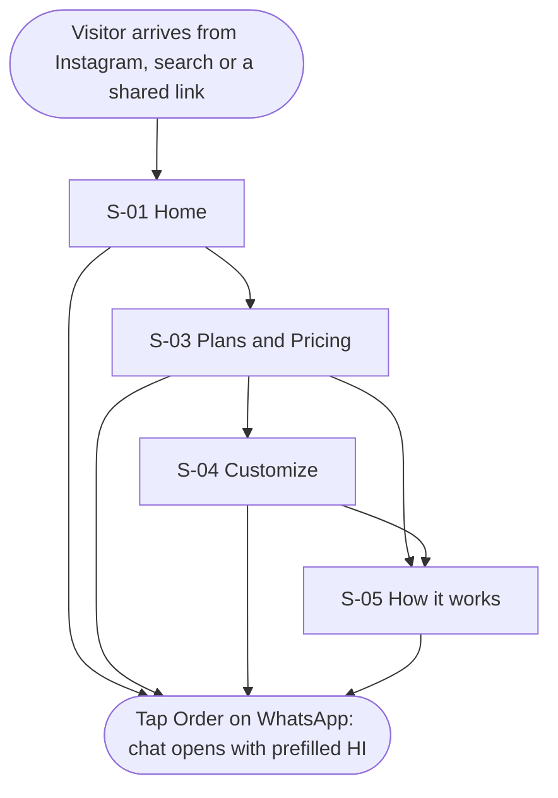
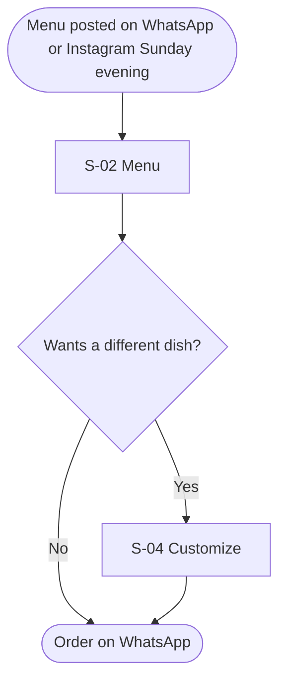
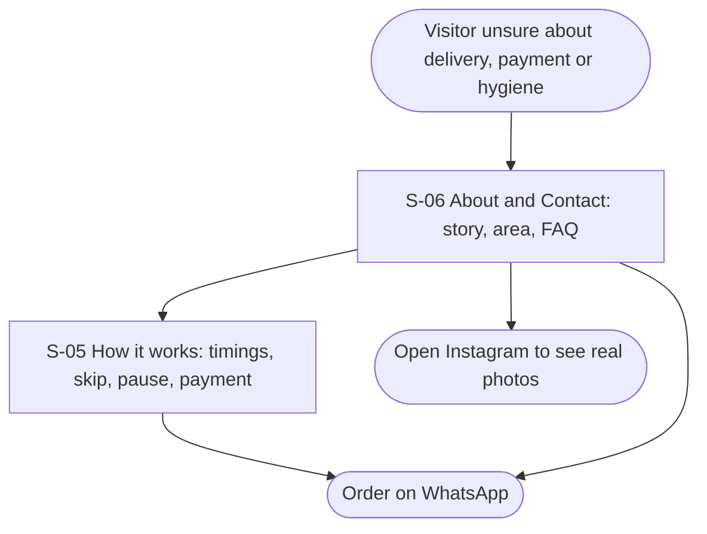
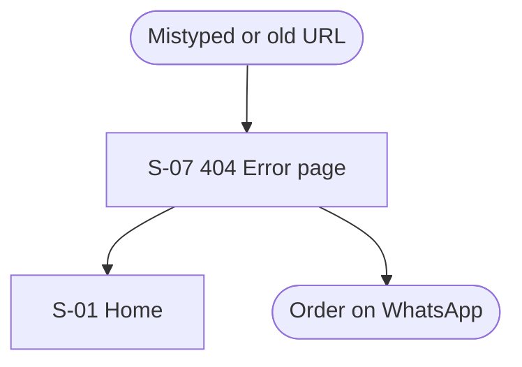
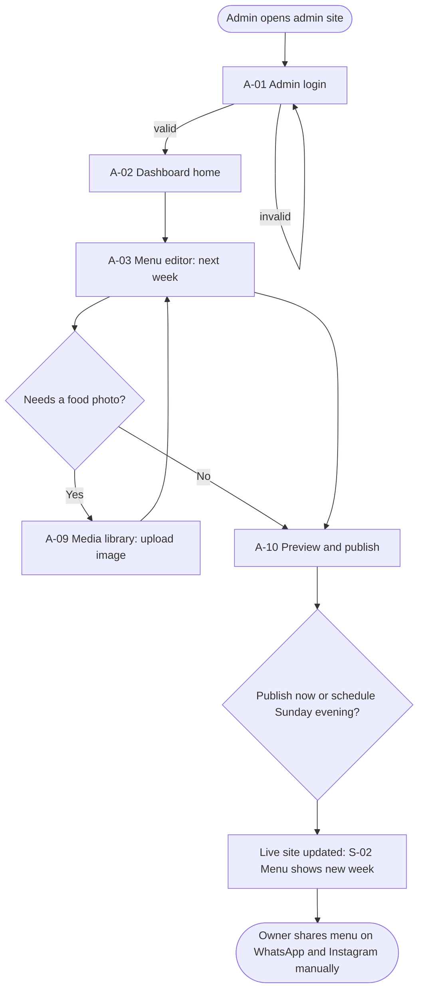
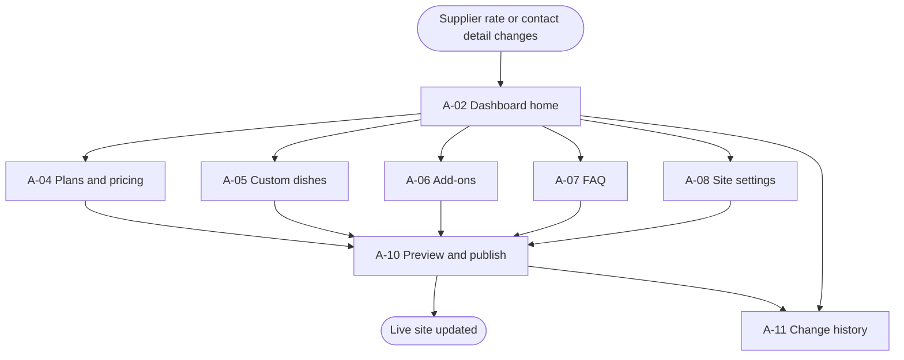
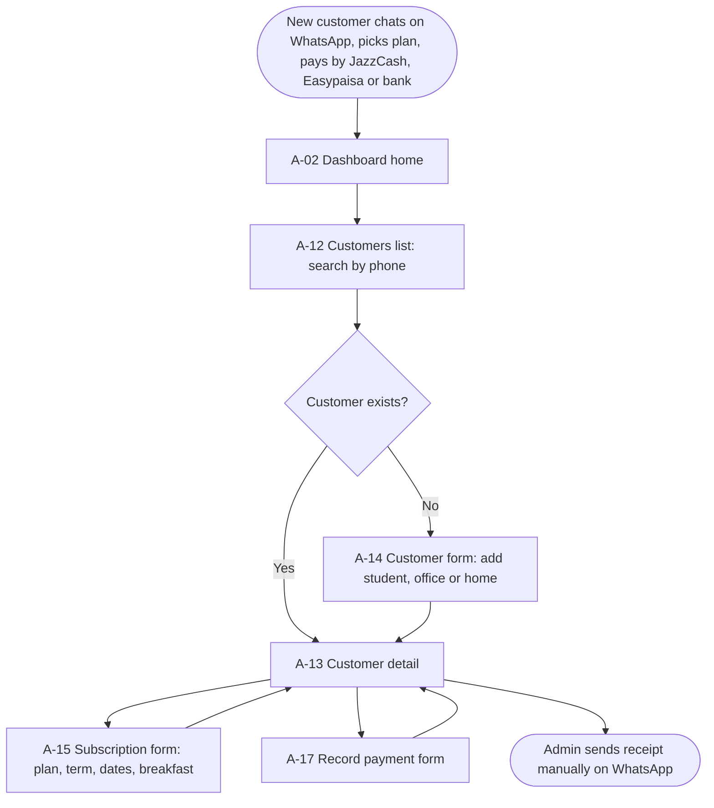
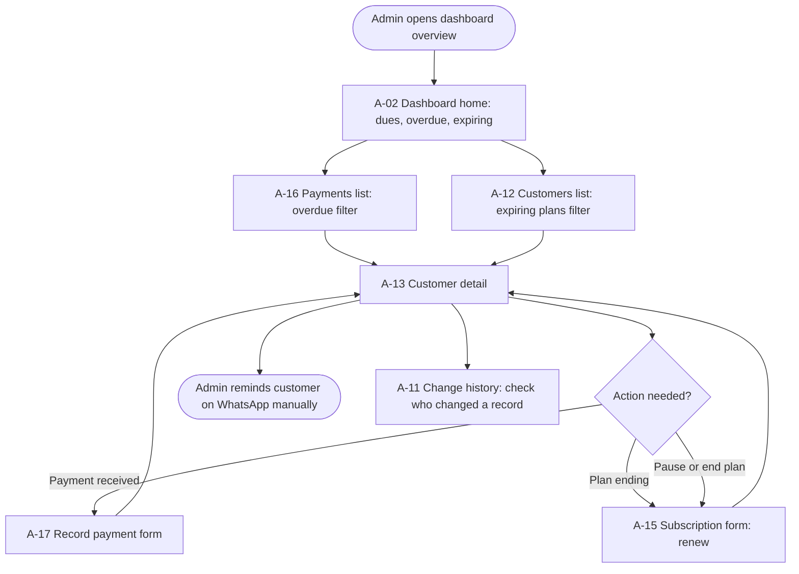

# PRD — Tiffin Box website + admin dashboard
Version: v0.2 · Status: Draft for CEO review (Stage 0) · Owner: requirements-pm · Date: 2026-11-21

Sources: `intake/client/tiffin-box-brief.pdf` (7 pages, "the brief", single source of truth for content, prices, brand, pages) and `intake/intake.md`. The admin dashboard, including customer / subscription / payment tracking, comes from verbal Engineering Lead instructions (cited as "session instruction 2026-11-21"); it is NOT in the brief and the client has not confirmed it.
Convention: "A-nn" = assumption (section 10), "Q-nn" = open question (section 11). Page references are brief pages.

## 1. Summary & goals
Tiffin Box is a weekly meal subscription delivering home-style Pakistani food to hostel students and offices in Johar Town, Lahore (around UMT). Customers today start by sending "HI" on WhatsApp and pay manually by JazzCash, Easypaisa or bank transfer (brief p1-2, p4).

**Product:** (a) a mobile-first public marketing website of six pages whose job is to make visitors hungry and move them to WhatsApp; (b) a private admin dashboard where staff manage site content (menu, prices, FAQ, settings) and keep staff-entered records of customers, subscriptions and manual payments.

**Goals**
1. G1: Every visitor is one tap from starting an order on WhatsApp, on every page (brief p5-6).
2. G2: Visitors can see this week's menu, the plans with prices, the customisation options and the rules (delivery, skip, pause, payment) without messaging first.
3. G3: The site looks and sounds like the existing logo, pamphlet and Instagram (brief p4-5).
4. G4: Staff can publish the weekly menu (due every Sunday evening) and change prices or settings with no code change.
5. G5: Staff can see at a glance who is subscribed, whose plan is expiring, and who has paid or owes money, from one place instead of chat history.
6. G6 (success measures, proposed, A-14): launch-ready by a CEO-agreed date; weekly menu update under 10 minutes; payment entry under 1 minute.

**Not a goal in v1:** customers ordering, signing up, logging in or paying on the website (section 3).

## 2. Users & roles (role → permissions table)
| Role | Who | Permissions |
|---|---|---|
| Visitor | Anyone on the public site: hostel students, office staff/managers, people who cannot cook, their families (brief p1) | Read all public pages; tap WhatsApp / Instagram links. No account, no data entry. |
| Admin | Tiffin Box owner/staff (number of admins and any role split: Q-02; assumed one role with full rights, A-06) | Log in to the dashboard; manage menu, plans, prices, dishes, add-ons, FAQ, settings, images; preview and publish; create/edit customers, subscriptions and payments; view the overview and change history. |
| Customer (data subject, not a user) | People and offices recorded by staff | No login and no access in v1. Their personal data is protected per NFR-12. |
| Developer/Createex (operational, not an app role) | Createex team | No access to live admin content or real customer data; production access only by CEO per runbook. |

## 3. Scope
### In scope (v1) — everything below needs CEO/client confirmation
**Public website** (A-01): six pages (Home, Menu, Plans & Pricing, Customize, How it works, About & Contact), mobile-first; logo top-left; persistent WhatsApp button; Instagram link; every page ends with a green "Order on WhatsApp" button (click-to-chat, prefilled "HI"); English / Roman-Urdu copy with Urdu script for the brand name only; plus a 404/error page (A-12).

**Admin dashboard, content management** (A-02): login; edit this week's menu incl. scheduling next week's; plans & prices; custom dishes; add-ons; FAQ; site settings (WhatsApp number, Instagram, order hours, delivery-area text, delivery/skip cut-off times); image upload; preview and publish.

**Admin dashboard, operations records (staff-entered only)** (CR-002, A-18): 
- Customer records: name, phone/WhatsApp, address/hostel/office, type (student / office / home); office teams with member count.
- Subscriptions: plan, weekly/monthly, start/end dates, breakfast add-on, status (active / paused / expired), renewals due.
- Payments: amount, method (JazzCash / Easypaisa / bank transfer), date, period covered, status (paid / unpaid / overdue), reference; recorded manually by admin.
- Overview: active subscribers, payments due, expiring plans.

### Out of scope
Out of v1 (brief p6 "Later, when ready", and session instruction):
- Online sign-up with payment; card payments or any online payment collection (brief p4, p6).
- Customer login (including to skip or pause meals); customers never access the system.
- Full Urdu version of the site.

Also out of v1 unless a change request is approved (not in the brief, not requested in session):
- Online ordering, cart, delivery tracking, rider app, mobile apps.
- Automated WhatsApp/Instagram posting of the Sunday menu (done manually, A-09).
- Visitor accounts, contact forms, reviews, blog, multi-area logic.

### Not in v1 pending client answer (open questions, not FRs)
These operations features were NOT included in the Engineering Lead's v1 instruction. They are listed so the client can decide; each would need a change request with time/cost:
- Skip and pause tracking, including the 3-skips-a-week rule, cut-off enforcement and automatic plan extension (Q-28). In v1 the admin can only set a subscription's status to "paused" manually and edit its end date.
- Office monthly invoice generation (Q-29).
- WhatsApp receipt sending or generation (Q-30); receipts stay manual on WhatsApp (brief p4).
- Daily delivery lists and kitchen counts (Q-31).
- Separate admin roles/permissions (Q-02).
- Refund handling for late/missed deliveries (Q-17).

## 4. Functional requirements
Priority: Must / Should / Could. Roles: V = Visitor, A = Admin.

| ID | Requirement | Role | Priority | Source |
|---|---|---|---|---|
| FR-01 | Every public page shows the logo top-left (links to Home) and navigation to the six pages | V | Must | Brief p6 "Must-haves", p5 |
| FR-02 | A WhatsApp button stays visible on screen on every public page; opens WhatsApp click-to-chat with prefilled "HI" | V | Must | Brief p1, p6 |
| FR-03 | Every public page ends with a green "Order on WhatsApp" button (same click-to-chat behaviour) | V | Must | Brief p5 |
| FR-04 | Every public page links to Instagram @tiffinbox.lhr | V | Must | Brief p1, p6 |
| FR-05 | Home page: headline "Bhook lagi? Khana hazir.", tagline, food photo, 3 benefits, "Meals from Rs 300", who we serve, how it works (3 steps), order button | V | Must | Brief p1, p5 |
| FR-06 | Menu page: this week's menu (Mon-Sun x breakfast/lunch/dinner), week label, link to Customize | V | Must | Brief p3, p5 |
| FR-07 | Plans & Pricing page: plans table, monthly 5% saving, office team deal, breakfast add-on, all prices from admin data | V | Must | Brief p2, p5 |
| FR-08 | Customize page: custom dishes with prices and add-ons list | V | Must | Brief p2-3, p5 |
| FR-09 | How it works page: 3 steps, delivery times, skip and pause rules, payment methods | V | Must | Brief p1-2, p4, p6 |
| FR-10 | About & Contact page: our story, area served, FAQ, WhatsApp, Instagram, Johar Town Lahore, order hours | V | Must | Brief p6-7 |
| FR-11 | FAQ list (admin-managed) displayed on About & Contact | V | Must | Brief p6 |
| FR-12 | Friendly 404/error page with links back to Home and WhatsApp | V | Should | PM proposal (A-12) |
| FR-13 | Admin login, logout, session expiry and password change | A | Must | Session instruction 2026-11-21 |
| FR-14 | Admin edits the current week's menu (each day x breakfast/lunch/dinner) | A | Must | Session instruction 2026-11-21; brief p2-3 (Sunday update) |
| FR-15 | Admin prepares next week's menu as a draft and schedules when it goes live | A | Must | Session instruction 2026-11-21; brief p2 |
| FR-16 | Admin manages plans, prices and pricing rules (monthly saving %, breakfast add-on price, team-deal text) | A | Must | Session instruction 2026-11-21; brief p2 ("prices may change") |
| FR-17 | Admin manages custom dishes (name, "comes with", price, order) | A | Must | Session instruction 2026-11-21; brief p2-3 |
| FR-18 | Admin manages add-ons (name, price, order) | A | Must | Session instruction 2026-11-21; brief p3 |
| FR-19 | Admin manages FAQ entries (question, answer, order) | A | Must | Session instruction 2026-11-21; brief p6 |
| FR-20 | Admin manages site settings: WhatsApp number, Instagram handle, order hours, delivery-area text, delivery times and skip cut-off times | A | Must | Session instruction 2026-11-21; brief p4, p6-7 |
| FR-21 | Admin uploads and manages food images for use in menu, dishes and pages | A | Must | Session instruction 2026-11-21; brief p5 |
| FR-22 | Admin previews changes and publishes them to the live site | A | Must | Session instruction 2026-11-21 |
| FR-23 | Admin sees who changed what and when (change history, covering content and customer/subscription/payment records) | A | Should | PM proposal (A-13); raised from Could because money and personal data are now stored |
| FR-24 | Admin creates, edits and archives customer records (name, phone/WhatsApp, address/hostel/office, type student/office/home; office: organisation, contact person, member count) | A | Must | Session instruction 2026-11-21 |
| FR-25 | Admin lists, searches and filters customers and opens a customer detail view showing their subscriptions and payments | A | Must | Session instruction 2026-11-21 |
| FR-26 | Admin creates and edits subscriptions for a customer (plan, weekly/monthly, start/end dates, breakfast add-on, status, notes) | A | Must | Session instruction 2026-11-21 |
| FR-27 | System shows subscription status (active / paused / expired) and flags renewals due and expiring plans | A | Must | Session instruction 2026-11-21 |
| FR-28 | Admin manually records payments against a customer/subscription (amount, method, date, period covered, reference) | A | Must | Session instruction 2026-11-21; brief p4 (manual methods) |
| FR-29 | System shows payment status (paid / unpaid / overdue) per subscription period and lists dues | A | Must | Session instruction 2026-11-21; brief p4 (advance payment) |
| FR-30 | Dashboard overview shows active subscribers, payments due/overdue and expiring plans, linking to the filtered lists | A | Must | Session instruction 2026-11-21 |

### Reference data from the brief (seed content, unconfirmed; do not hardcode, see FR-16)
| Plan | For | Meals | Per meal | Weekly | Observation |
|---|---|---|---|---|---|
| Budget | Hostel students | Lunch + dinner, daal or sabzi + 2 roti | Rs 300 | Rs 4,200 | = 300 x 14 meals (7 days) |
| Student (most popular) | Students wanting full menu | Lunch + dinner, full weekly menu | Rs 550-600 | Rs 8,050 | = 575 x 14; range unresolved (Q-08) |
| Office Lunch | Offices, working people | Lunch only, Mon-Sat, by 1 PM | Rs 550 | Rs 3,300 | = 550 x 6 |
| All 3 Meals | People who don't cook | Breakfast + lunch + dinner | Rs 1,500 per day | Rs 10,500 | = 1,500 x 7 |

Breakfast add-on Rs 350/day; monthly plans save 5%; custom meals Rs 50-150 more than a plan meal; custom dishes Rs 400-750; add-ons Rs 20-90 (brief p2-3). Payment is in advance: weekly before the week starts (Sunday), monthly before the month starts, offices one monthly invoice (brief p4).

## 5. Acceptance criteria
Format: Given / When / Then. "Admin-managed content" means data edited in the dashboard, not hardcoded.

### FR-01
- Given any public page on a 360px-wide phone, When it loads, Then the logo is at the top-left and tapping it opens Home.
- Given any public page, When the visitor opens the navigation, Then links to all six pages are present and the current page is indicated.

### FR-02
- Given any public page, When the visitor scrolls anywhere, Then the WhatsApp button remains visible and does not cover primary content or the end-of-page button.
- Given the button, When tapped on a phone with WhatsApp, Then WhatsApp opens a chat with the admin-configured number and the message "HI" prefilled.
- Given a desktop browser, When clicked, Then WhatsApp Web / the WhatsApp landing page opens with the same number and text.
- Given the WhatsApp number is changed in settings and published, When any page is reloaded, Then all WhatsApp links use the new number (no hardcoded number).

### FR-03
- Given any public page, When the visitor reaches the bottom, Then a green button labelled "Order on WhatsApp" is the last content block above the footer and behaves as in FR-02.
- Given the button, When rendered, Then the label colour meets contrast requirements (NFR-03).

### FR-04
- Given any public page, When viewed, Then a visible Instagram link to the configured handle (default @tiffinbox.lhr) opens in a new tab with rel="noopener".
- Given the handle is changed in settings and published, Then the link updates on all pages.

### FR-05
- Given the Home page, When loaded, Then it shows, in order: the headline "Bhook lagi? Khana hazir.", the tagline "Ghar ka khana, Ammi ke pyaar jaisa", a real food photo, the 3 benefits, "Meals from Rs [lowest plan price]", who we serve (hostel students, offices/working people, people who can't cook), the 3-step how-it-works, and the order button.
- Given the lowest plan price is changed in the dashboard, When published, Then "Meals from Rs ..." updates (A-10).
- Given the 3 benefits or the photo are not yet supplied (Q-14, Q-13), Then the page uses clearly marked placeholders that must be replaced before launch.

### FR-06
- Given a published menu for the current week, When the visitor opens Menu, Then a table shows all seven days with breakfast, lunch (1 PM) and dinner (8 PM) items and a week label (e.g. "Menu for 23-29 Nov").
- Given a phone, Then the menu is readable without horizontal page scroll (day cards or scrollable table; Stage 1 decision).
- Given a link "Customize your meal", When tapped, Then Customize opens.
- Given no menu is published for the current week, Then the page shows the most recent published menu with a "last updated" date, never an empty page.

### FR-07
- Given Plans & Pricing, When loaded, Then each active plan shows name, who it is for, meals included, per-meal price and weekly price, as entered in the dashboard.
- Given the page, Then the monthly 5% saving, the office team deal (10+ people, one monthly invoice) and the breakfast add-on (Rs 350/day) are shown, with values from admin data.
- Given a price is edited and published, Then the new price shows everywhere it is referenced, with no code change.
- Given the Student plan price is unresolved (Q-08), Then it is not published until one confirmed figure is entered.

### FR-08
- Given Customize, When loaded, Then it lists custom dishes with "comes with" and price, and the add-ons with prices, as managed in the dashboard.
- Given the page, Then it states the custom-meal premium rule only once the client has confirmed its wording (Q-21).

### FR-09
- Given How it works, When loaded, Then it shows the 3 steps (message us, pick a plan and pay, eat on time), delivery times (breakfast 8 AM, lunch 1 PM, dinner 8 PM), skip rules, pause rule, and payment methods (JazzCash, Easypaisa, bank transfer).
- Given the skip rules, Then the cut-offs (breakfast 10 PM the night before, lunch 10 AM same day, dinner 5 PM same day; up to 3 skips a week; skipped meals added to the end of the plan) come from admin settings.
- Given the skip/pause text, Then it states that skipping and pausing is requested on WhatsApp (A-08).

### FR-10
- Given About & Contact, When loaded, Then it shows our story, the area served (Johar Town, Lahore, around UMT; more areas coming), the FAQ (FR-11), WhatsApp, Instagram and order hours.
- Given a brief placeholder ([YOUR NUMBER], [YOUR WEBSITE], [YOUR HOURS]) has not been replaced, Then the publish check flags it and it cannot go live (Q-04 to Q-06).

### FR-11
- Given FAQ entries exist in the dashboard, When About & Contact loads, Then they appear in admin-defined order as expandable question/answer items, operable by keyboard.
- Given an FAQ is added, edited, reordered or deleted and published, Then the page reflects it.

### FR-12
- Given a URL that does not exist, When requested, Then a branded 404 page with a link to Home and the WhatsApp button is shown with a 404 status.
- Given the content data cannot be loaded, Then the page shows a readable fallback, not a blank screen.

### FR-13
- Given valid admin credentials, When submitted on the login page, Then the admin reaches the dashboard.
- Given wrong credentials, Then access is refused with a generic message and repeated failures are throttled (NFR-07).
- Given an unauthenticated request to any admin page or admin API (including customer, subscription and payment data), Then it is rejected and redirected to login.
- Given an idle session beyond the configured timeout, Then the admin must log in again.
- Given a logged-in admin, When they change their password with the current one, Then the new password applies at next login.

### FR-14
- Given the menu editor, When the admin opens the current week, Then they can edit the dish text for each of the 21 slots (7 days x 3 meals), save as draft, and see the change on preview (FR-22).
- Given an empty slot (e.g. no breakfast that day), Then the admin can mark it "not served" instead of leaving it ambiguous.
- Given invalid input (over-long text, markup), Then it is rejected or safely escaped with a clear message.

### FR-15
- Given the menu editor, When the admin creates next week's menu, Then it is stored as a draft that does not change the live site.
- Given a draft with a go-live date/time (default Sunday evening, time per Q-24), When that time arrives, Then it becomes the live menu without admin action; the admin can alternatively publish immediately.
- Given a scheduled menu, When the admin edits or cancels the schedule before go-live, Then the change takes effect and the live menu is untouched.
- Given "copy last week", Then all 21 slots are pre-filled and editable.

### FR-16
- Given the plans editor, When the admin edits a plan's name, audience, meals included, per-meal price, weekly price, "most popular" flag, display order or active state, Then the change is saved as a draft.
- Given the pricing-rules form, When the admin edits the monthly saving %, breakfast add-on price or team-deal text, Then it is saved as a draft.
- Given a price field, When a non-numeric or negative value is entered, Then it is rejected.
- Given Q-10 is resolved as a computed monthly price, Then the dashboard shows the computed value for the admin to verify before publishing.
- Given a plan price is changed, Then existing subscriptions keep the price recorded when they were created (A-20).

### FR-17
- Given the dishes screen, When the admin adds, edits, reorders, hides or deletes a custom dish (name, comes-with, price, optional photo), Then the draft updates and Customize reflects it after publishing.

### FR-18
- Given the add-ons screen, When the admin adds, edits, reorders, hides or deletes an add-on (name, price), Then the draft updates and Customize reflects it after publishing.

### FR-19
- Given the FAQ screen, When the admin adds, edits, reorders or deletes an entry, Then the draft updates and About & Contact reflects it after publishing.

### FR-20
- Given the settings screen, When the admin edits WhatsApp number, Instagram handle, order hours, delivery-area text, delivery times and skip cut-off times, Then values are validated (WhatsApp number in international format, digits only; valid times) and saved as a draft.
- Given a settings change is published, Then every page that displays that value shows the new one.

### FR-21
- Given the media screen or an image picker, When the admin uploads a JPG/PNG/WebP within the size limit (set by architect), Then it is stored, resized into web-optimised variants and available for selection; alt text is required.
- Given an unsupported or oversized file, Then upload is rejected with a clear message and nothing is stored.
- Given an image is in use, When the admin tries to delete it, Then they are warned where it is used.

### FR-22
- Given unpublished content drafts, When the admin opens Preview, Then public pages render with draft content, clearly marked as preview and not indexable.
- Given the admin chooses Publish and confirms, Then the live site shows the changes within NFR-06's time, and the publish time is recorded.
- Given a publish fails, Then the live site stays on the previous published version and the admin is told.
- Given drafts exist, Then the dashboard shows an "unpublished changes" indicator.
- Note: customer, subscription and payment records are saved immediately and are never published to the public site.

### FR-23
- Given any content publish, or any create/edit/archive of a customer, subscription or payment, When the admin opens Change history, Then they see date/time, admin user, record type and what changed, newest first.
- Given a payment record is edited or voided, Then the previous values remain visible in history.

### FR-24
- Given the customer form, When the admin enters name, phone/WhatsApp number, address/hostel/office and type (student / office / home) and saves, Then the customer is created and appears in the list.
- Given type "office", Then the form also requires organisation name, contact person and member count (whole number >= 1); the member count is shown on the customer list and detail.
- Given a name, phone and type are required and missing or invalid (phone not a valid Pakistani mobile/WhatsApp number format), Then saving is blocked with a field-level message.
- Given a phone number that already exists on another customer, Then the admin is warned about a possible duplicate before saving.
- Given an existing customer, When the admin edits any field and saves, Then the change is stored and appears in change history (FR-23).
- Given a customer with no active subscription, When the admin archives them, Then they are hidden from default lists but their records remain; a customer with an active subscription cannot be archived until it is ended or the admin confirms.
- Given the admin chooses "delete personal data" for a customer (Q-34), Then this is a separate confirmed action, not the default archive.

### FR-25
- Given the customer list, When the admin types a name, phone number or organisation, Then results filter as they type (or on submit) and match partial text.
- Given filters for type (student / office / home), subscription status and payment status, When applied, Then only matching customers are shown, with a count.
- Given a customer row, When opened, Then the detail view shows profile, subscriptions (with status) and payments (with status), and buttons to add a subscription or record a payment.
- Given zero customers or zero matches, Then an empty state with an "Add customer" action is shown.

### FR-26
- Given a customer, When the admin adds a subscription with plan (from the active plans list), term (weekly/monthly), start date and breakfast add-on yes/no, Then the end date is proposed from the term and start date and is editable, and the subscription is saved.
- Given a plan is selected, Then the amount per period defaults from the plan's current price (and breakfast add-on price if selected) and is stored on the subscription; the admin can override it with a note (A-20).
- Given an end date before the start date, Then saving is blocked.
- Given a customer already has an overlapping active subscription, Then the admin is warned before saving.
- Given an existing subscription, When the admin edits plan, dates, add-on, status or notes, Then the change is stored and appears in change history.
- Given the admin sets status to "paused" or later "active" again, Then it is saved as a manual status change with a date; the system does not calculate skips or extend the plan automatically (Q-28).
- Given a renewal, When the admin chooses "Renew", Then a new subscription is created pre-filled from the previous one, starting the day after it ends.

### FR-27
- Given a subscription, Then its status is: Active when today is within start-end dates and not manually paused; Paused when manually paused; Expired when the end date has passed.
- Given a subscription whose end date is within N days (N default 7, adjustable in settings, Q-33), Then it is flagged "Renewal due" in the customer detail and in the expiring list.
- Given the date passes the end date, Then the status shows Expired without admin action (computed on read or by a scheduled job; architect decides).
- Given the admin filters subscriptions by status, Then only matching ones are shown.

### FR-28
- Given a customer detail or the payments screen, When the admin records a payment with amount (PKR, whole rupees > 0), method (JazzCash / Easypaisa / bank transfer), payment date, subscription and period covered (start-end), and an optional reference (e.g. transaction ID) and note, Then the payment is saved and shown in the customer's history.
- Given a missing amount, method, date or period, Then saving is blocked with field-level messages.
- Given a reference that already exists on another payment of the same method, Then the admin is warned of a possible duplicate.
- Given a payment was recorded in error, When the admin edits or voids it with a reason, Then the original values are retained in change history and totals update.
- Given a payment date in the future, Then the admin is warned.
- The system does not contact payment providers or send receipts (Q-30).

### FR-29
- Given a subscription period with an amount due and a due date (before the period starts, brief p4), When no payment covering it is recorded and the due date has not passed, Then its status is Unpaid.
- Given the due date has passed and the period is not fully paid, Then its status is Overdue (grace days: Q-32).
- Given recorded payments covering at least the amount due for the period, Then its status is Paid.
- Given a payment less than the amount due, Then the period shows the remaining balance and stays Unpaid/Overdue (partial payments: Q-35, assumed allowed and shown).
- Given the payments list, When the admin filters by status, method or date range, Then only matching rows are shown, with a total amount.
- Given an office customer, Then payments and dues are tracked on the office's single record (A-19).

### FR-30
- Given the admin opens the dashboard home, Then it shows: number of active subscribers, number and total amount of unpaid and overdue payments, and number of plans expiring within N days (FR-27).
- Given a card, When tapped, Then it opens the corresponding list already filtered (active subscriptions, dues, overdue, expiring).
- Given customer data changes, When the dashboard is reloaded, Then the counts match the underlying lists (same definitions as FR-27 and FR-29).
- Given no data yet, Then zeros and a short "add your first customer" hint are shown.
- The overview also shows the content-publishing indicator and the scheduled menu (FR-22, FR-15).

## 6. Non-functional requirements
Numeric targets are PM proposals (A-15) for the architect and CEO to confirm.

- **NFR-01 Performance (low-end Android, slow 4G).** Public pages: LCP <= 2.5 s on a mid/low-end Android with throttled slow 4G (about 1.6 Mbps, 150 ms RTT); initial transfer <= 500 KB per page excluding the hero image; responsive, compressed (WebP/AVIF), lazy-loaded images; no render-blocking third-party scripts; Lighthouse mobile performance >= 90 on every public page. No full Nastaliq webfont on every page (Urdu appears only in the brand name; use the logo asset, A-05). Admin list screens stay responsive with at least 1,000 customers (proposed).
- **NFR-02 Mobile-first responsiveness.** Designed at 360 px first; verified at 360, 390, 768 and 1280 px; no horizontal page scroll (data tables may scroll inside their own container); tap targets >= 44 px; the persistent WhatsApp button does not obscure content.
- **NFR-03 Accessibility.** Target WCAG 2.1 AA. Contrast must be checked in Stage 1. PM's own rough calculation (not yet verified with a tool): gold #F2B441 on cream #FAF6EE is about 1.7:1, which FAILS 4.5:1 for text and 3:1 for UI boundaries; gold on deep green #1F5134 is about 5:1 and deep green on cream about 8.5:1; brown #A9561A on cream about 4.8:1. Therefore gold is not used for text or button edges on cream, and the label on the green WhatsApp button must pass 4.5:1. Also: semantic headings, alt text for every image, visible focus, keyboard-operable nav/FAQ/forms, `lang` attributes (en; `ur` for the brand name).
- **NFR-04 SEO and sharing.** Server-rendered or pre-rendered HTML; unique title and meta description per page; one H1 per page; sitemap.xml and robots.txt; canonical URLs; LocalBusiness/FoodEstablishment structured data (Johar Town, Lahore) using only confirmed details; Open Graph / Twitter tags with a share image so WhatsApp and Instagram link previews look right; admin and preview pages `noindex`. Google Business Profile setup is out of scope (Q-22).
- **NFR-05 Brand tokens.** Colours as tokens: deep green #1F5134, gold #F2B441, cream #FAF6EE, warm brown #A9561A. Fonts: Space Grotesk Bold (headings), Inter (body); Urdu font Noto Nastaliq Urdu or Gulzar only if needed (Q-19). Voice: warm, simple Roman Urdu mixed with English, short sentences, no jargon. Real food photos only, no stock (brief p4-5).
- **NFR-06 Content freshness.** A published change is visible to visitors within 60 seconds (proposed).
- **NFR-07 Admin security basics.** HTTPS only; passwords hashed with a modern algorithm and never logged; login throttling/lockout; secure, expiring sessions; CSRF and XSS protection; server-side authorisation on every admin endpoint (including all customer, subscription and payment endpoints); upload validation (type, size, content) with metadata stripped; no secrets in the repo; admin not linked from the public site; dependency audit before release. Security review at Stage 4.
- **NFR-08 Availability and resilience.** Public site stays up if the admin/backend is down (static/cached content); target 99.5% monthly (proposed); all data (content and customer/subscription/payment records) backed up automatically with a documented, tested restore; a content publish can be rolled back.
- **NFR-09 Localisation.** UI and copy in English / Roman Urdu; Urdu script only for the brand name; UTF-8 throughout (customer names may be in Urdu script and must store and display correctly); prices as "Rs 4,200"; money stored as whole PKR; 12-hour times; dates in Asia/Karachi timezone; admin UI English (Q-23).
- **NFR-10 Browser/device support (proposed).** Last 2 versions of Chrome and Samsung Internet on Android 8+, Safari on iOS 15+, current desktop Chrome, Edge, Firefox, Safari.
- **NFR-11 Public-site privacy.** The public site collects no personal data in v1 (no forms, no accounts); analytics or cookies only if approved (Q-22) with a short privacy note.
- **NFR-12 Personal-data protection (customer records).** Customer names, phone numbers, addresses and payment history are personal and financial data. Required: access only for authenticated admins; encryption in transit (HTTPS) and at rest (provider-level encryption); minimal data collected (only the fields in FR-24, 26, 28); customer data never exposed on public pages, previews, URLs, logs, error messages or analytics; secrets and database credentials outside the repo; no real customer data in development or staging (synthetic test data only); backups protected as the live data; data export restricted to admins and recorded in change history; ability to archive and, on request, delete or anonymise a customer (Q-34); retention period defined (Q-34); every change audited (FR-23); no copying data between client projects. Applicable Pakistani legal requirements are not assessed here and need confirmation (Q-34). Security-engineer review of this data at Stage 4.

## 7. Screen inventory
Shared components on every public screen (not separate screens): header with logo and nav (FR-01), persistent WhatsApp button (FR-02), end-of-page Order button (FR-03), Instagram link (FR-04), footer.

| Screen ID | Name | Platform | Role | FRs | States needed |
|---|---|---|---|---|---|
| S-01 | Home | Web (mobile-first) | Visitor | FR-01..05 | default; loading images; placeholder content |
| S-02 | Menu | Web (mobile-first) | Visitor | FR-01..04, 06 | default; no-current-menu fallback; updated-date |
| S-03 | Plans & Pricing | Web (mobile-first) | Visitor | FR-01..04, 07 | default; "most popular" state |
| S-04 | Customize | Web (mobile-first) | Visitor | FR-01..04, 08 | default; empty add-ons |
| S-05 | How it works | Web (mobile-first) | Visitor | FR-01..04, 09 | default |
| S-06 | About & Contact | Web (mobile-first) | Visitor | FR-01..04, 10, 11 | default; FAQ collapsed/expanded |
| S-07 | 404 / Error | Web (mobile-first) | Visitor | FR-01..04, 12 | not found; data load failure |
| A-01 | Admin login | Web (admin) | Admin | FR-13 | default; error; throttled; session expired |
| A-02 | Dashboard home / overview | Web (admin) | Admin | FR-13, 22, 30 | default; empty (no customers); unpublished-changes indicator; scheduled menu shown |
| A-03 | Menu editor (this week / next week) | Web (admin) | Admin | FR-14, 15, 21 | empty; draft; scheduled; validation error; saved |
| A-04 | Plans & pricing editor | Web (admin) | Admin | FR-16 | default; validation error; saved |
| A-05 | Custom dishes manager | Web (admin) | Admin | FR-17, 21 | empty; list; add/edit; delete confirm |
| A-06 | Add-ons manager | Web (admin) | Admin | FR-18 | empty; list; add/edit; delete confirm |
| A-07 | FAQ manager | Web (admin) | Admin | FR-19 | empty; list; add/edit; reorder |
| A-08 | Site settings | Web (admin) | Admin | FR-13 (password), 20, 27 (renewal window) | default; validation error; saved |
| A-09 | Media library / image picker | Web (admin) | Admin | FR-21 | empty; uploading; error; in-use warning |
| A-10 | Preview & publish | Web (admin) | Admin | FR-22 | no changes; changes pending; publishing; success; failure |
| A-11 | Change history | Web (admin) | Admin | FR-23 | empty; list; filter by record type |
| A-12 | Customers list | Web (admin) | Admin | FR-24, 25, 27, 29 | empty; list; search/filter; no results |
| A-13 | Customer detail (profile, subscriptions, payments) | Web (admin) | Admin | FR-25, 26, 27, 28, 29 | default; office team view; archived; renewal due; overdue |
| A-14 | Customer form (add / edit) | Web (admin) | Admin | FR-24 | new; edit; validation error; duplicate-phone warning; saved |
| A-15 | Subscription form (add / edit / renew) | Web (admin) | Admin | FR-26, 27 | new; edit; renew pre-filled; validation error; overlap warning |
| A-16 | Payments list (ledger and dues) | Web (admin) | Admin | FR-28, 29 | empty; list; filters; overdue highlighted; totals |
| A-17 | Record payment form | Web (admin) | Admin | FR-28 | new; edit/void; validation error; duplicate-reference warning; saved |

Admin screens should be usable on a phone and on a desktop (Q-23).

## 8. User journeys (Mermaid flowcharts)
**J1: New visitor decides to order (covers S-01, S-03, S-04, S-05)**

**J2: Customer checks this week's menu on Sunday evening (covers S-02, S-04)**

**J3: Sceptical visitor builds trust (covers S-06, S-05)**

**J4: Visitor hits a bad link (covers S-07)**

**J5: Admin publishes the weekly menu every Sunday (covers A-01, A-02, A-03, A-09, A-10)**

**J6: Admin changes prices, dishes, FAQ or settings and reviews history (covers A-04 to A-08, A-10, A-11)**

**J7: Admin signs up a new customer after a WhatsApp "HI" and records first payment (covers A-12, A-14, A-13, A-15, A-17)**

**J8: Admin follows up dues and renewals (covers A-02, A-16, A-13, A-15, A-17, A-11)**

## 9. Integrations & dependencies
| Item | v1 use | Status |
|---|---|---|
| WhatsApp click-to-chat (wa.me link, text "HI") | All order buttons; number from admin settings. No WhatsApp API: reminders and receipts are sent manually by staff | Number not provided (Q-04) |
| Instagram @tiffinbox.lhr | Link only (no API/feed embed) | Handle per brief; confirm (Q-04) |
| Hosting, database, image storage, admin auth, backups | To be chosen by architect. A database with customer/payment data is now required | Budget/ownership unknown (Q-03) |
| Domain / DNS | Needed at launch; DNS changes executed by CEO per production runbook | Domain not provided (Q-05) |
| Analytics | Optional | Not decided (Q-22) |
| Payments (JazzCash, Easypaisa, bank) | Manual entry only; no provider integration, no reconciliation, no online payments or cards | Out of v1 |
| Existing customer data (WhatsApp chats, notebooks, spreadsheets) | Possible one-time import; not in v1 unless requested | Q-36 |
| Maps | None; delivery area is text only | Boundary unknown (Q-11) |
| Email (e.g. admin password reset) | Only if architect chooses email reset | Open (Q-02) |
Dependencies on the client: logo files, photos, copy (Q-12 to Q-15), confirmed prices (Q-07 to Q-10), operations rules (Q-28 to Q-36).

## 10. Assumptions
All need CEO/client confirmation; none is a fact.
- A-01: The public site has exactly the six pages in the brief, plus a 404 page.
- A-02: Admin v1 includes content management (FR-13 to FR-22) and staff-entered customers, subscriptions, payments and an overview (FR-24 to FR-30); requested verbally by the Engineering Lead, not in the brief; scope pending Q-01.
- A-03: "Later, when ready" items (online sign-up with payment, customer login, full Urdu version, card payments) are out of v1.
- A-04: Visitors never enter data on the site; ordering happens in WhatsApp.
- A-05: The Urdu brand name appears only inside the logo asset (image/SVG) supplied by the client, so no Urdu webfont is loaded for body text.
- A-06: One admin role (all admins have full rights); number of admin accounts to be confirmed (Q-02).
- A-07: Menu week runs Monday-Sunday per the sample menu; the next week's menu goes live Sunday evening; the switchover moment is to be confirmed (Q-24).
- A-08: Skipping and pausing are requested on WhatsApp; the website only explains the rules (brief p4).
- A-09: The owner posts the Sunday menu to WhatsApp and Instagram manually.
- A-10: "Meals from Rs 300" is derived from the lowest active plan price; all prices come from admin data.
- A-11: The sample menu and dishes in the brief are seed content only.
- A-12: A 404/error page is included (not in the brief; small, standard).
- A-13: Change history (FR-23) is Should priority because money and personal data are stored.
- A-14: Success measures in G6 are proposals, not client-stated.
- A-15: Numeric NFR targets (performance, availability, freshness, browser versions, list sizes) are PM proposals pending architect/CEO.
- A-16: Static copy (Home benefits, About story, How-it-works step text) is developer-maintained in v1 and is NOT editable in the dashboard (Q-15).
- A-17: Prices are in PKR and as printed in the brief until the client confirms final figures.
- A-18: Operations records (customers, subscriptions, payments) are staff-entered only; no customer login, no online payment, no payment-provider integration.
- A-19: An office is one customer record with an organisation name, contact person and member count; individual team members are not separate records; payments and dues are tracked per office.
- A-20: A subscription stores the amount per period at creation (from the plan price then); later price changes do not alter existing subscriptions unless an admin edits them.
- A-21: A weekly subscription period is 7 days and a monthly one 4 weeks or a calendar month (unresolved, Q-10); Office Lunch plan serves Mon-Sat only.
- A-22: Payment is due before the period starts (Sunday for weekly, brief p4); "overdue" means the due date has passed and the period is not fully paid; grace days default to 0 (Q-32).
- A-23: "Paused" is a manual status set by the admin; the system does not compute skips or extend end dates automatically (Q-28).
- A-24: "Expiring" means end date within 7 days (adjustable, Q-33).
- A-25: Partial payments are allowed and shown as a balance (Q-35).
- A-26: Customer records are archived (hidden), not deleted, by default; deletion/anonymisation is a separate action (Q-34).

## 11. Open questions for the client
Tag: **BD** = blocking-for-design (Stage 1), **BL** = blocking-for-launch, **NB** = non-blocking.

| # | Question | Why it matters | Tag |
|---|---|---|---|
| Q-01 | **Top question.** Confirm that admin v1 = content management + staff-entered customers, subscriptions, payments and overview (FR-13 to FR-30). This was not in the client's brief and needs the client's agreement; it adds large time/cost (CR-001, CR-002). Who is paying for it? | Defines screens, data model, security and budget | BD |
| Q-02 | Who will use the admin, how many people, and do they need different permissions (e.g. owner vs helper who can only record payments)? Is password reset by email needed? | Roles, auth design, FR-13 | BD |
| Q-03 | Who owns and pays for hosting, domain and cloud accounts? Budget and launch deadline? Contract status (CEO fills). | Architecture, timeline | BL |
| Q-04 | WhatsApp Business number for orders (brief: [YOUR NUMBER]); confirm Instagram handle @tiffinbox.lhr. | Order buttons, SEO data | BL |
| Q-05 | Website address (brief: [YOUR WEBSITE]) and domain ownership/registrar access. | Launch, SEO, DNS | BL |
| Q-06 | Order hours (brief: [YOUR HOURS], with "9 AM to 9 PM" only as an example) and the last time to order for next-day delivery. | About & Contact, How it works | BL |
| Q-07 | Final prices after the supplier bulk rate (brief p2 and p7: "confirm before publishing"). Who approves price changes later? | Plans, Customize | BL |
| Q-08 | Student plan: Rs 550, 600 or 575 per meal? (Weekly Rs 8,050 = 575 x 14 and All 3 Meals Rs 1,500 = 2 x 575 + 350 suggest 575, but the brief shows "Rs 550-600".) | One price must be shown | BL |
| Q-09 | Team discount for offices with 10+ people: amount, how applied, shown on the site or quoted on WhatsApp? | Plans & Pricing, office subscriptions | BL |
| Q-10 | How is the monthly price defined (4 weeks x weekly minus 5%? a calendar month?), for which plans, and what is the Office monthly price? | Plans, subscription end dates and amounts | BL |
| Q-11 | Exact delivery boundary inside Johar Town (blocks/hostels/landmarks to show). | Delivery-area text | BL |
| Q-12 | Logo files (round badge, roti-and-flame mark), pamphlet, Instagram assets. Please supply the Urdu brand name as an image/SVG; the brief's PDF text is mis-ordered when extracted. | Brand (NFR-05) | BD |
| Q-13 | Real food photos (tiffins, steaming roti, hands serving). Until then the design uses marked placeholders. | Home, Menu, Customize | BL |
| Q-14 | The three Home benefits (not spelled out in the brief) and the "Our story" text. | Home, About | BL |
| Q-15 | May static page text (benefits, story, how-it-works steps) be developer-maintained, or must the owner edit it in the admin? | Admin scope (A-16) | BD |
| Q-16 | Punjab Food Authority registration: do you have it, and may we show the number/badge? | Trust, legal | BL |
| Q-17 | Refund rule for late or missed deliveries and the wording to publish; should refunds be tracked in the admin? | FAQ, How it works, payments | BL |
| Q-18 | Button colour conflict: the brief lists gold for "accent, buttons" but requires a green "Order on WhatsApp" button. Which green (#1F5134 or WhatsApp's) and which text colour? | Design system, contrast | BD |
| Q-19 | Urdu font: Noto Nastaliq Urdu or Gulzar; is the brand name only as a logo image acceptable (faster loads)? | Performance, brand | NB |
| Q-20 | Plan start rules: weekly plans are paid by Sunday and "your first meal can arrive the next day". Which start days apply, and what is the order cut-off for a next-day start? | How it works, FAQ, subscription start dates | BL |
| Q-21 | Custom meals "cost Rs 50-150 more than a plan meal" versus fixed prices (Rs 400-750). Which plan is the base? (Daal chawal at Rs 550 is about the same as a Student meal; Fried fish at Rs 750 is 150-200 above it.) State the rule or show only fixed prices? | Customize copy | BL |
| Q-22 | Do you want analytics (visitor and WhatsApp-click counts) and a Google Business Profile? | NFR-04, NFR-11 | NB |
| Q-23 | Will the admin be used mainly on a phone or a computer? English admin UI acceptable? | Admin design | NB |
| Q-24 | Sunday menu: what time should next week's menu go live, when does "this week" switch over, and is manual publish preferred to scheduling? | FR-15 | NB |
| Q-25 | Which meals does the Menu page show per plan? The brief's single table includes breakfast, but Budget is "daal or sabzi + 2 roti" and Office is lunch only. One menu with plan notes? | Menu layout (FR-06) | BD |
| Q-26 | Is the brief's sample menu (and dish list) the real launch menu, or only an example? | Seed content | NB |
| Q-27 | Legal business name, address/contact for the footer, and who approves final website content. | Footer, sign-off | NB |
| Q-28 | Skip and pause tracking: should the admin record skipped meals with the 3-skips-a-week rule and cut-off checks (breakfast 10 PM before, lunch 10 AM, dinner 5 PM) and automatically add skipped meals to the end of the plan? Not in v1 as instructed; would need a change request. | Subscription logic, effort | BD |
| Q-29 | Office monthly invoice: should the admin generate invoices (format, tax/NTN, numbering) or is the monthly bill sent by hand? | Scope, legal | BD |
| Q-30 | WhatsApp receipts after every payment (brief p4): keep manual, or should the admin generate receipt text/PDF to copy? | Scope | NB |
| Q-31 | Daily delivery list / kitchen counts by meal and hostel/office: needed in the admin? | Scope, effort | BD |
| Q-32 | When is a payment "overdue": the day after the due date, or after grace days? Is service stopped on non-payment? | FR-29 definitions | NB |
| Q-33 | How many days before the end date should a plan be flagged "renewal due / expiring" (assumed 7)? | FR-27, FR-30 | NB |
| Q-34 | Customer data rules: how long to keep customer and payment records, who may export them, and how to handle a customer asking for deletion? Are there legal requirements the client knows of? | NFR-12, FR-24 | BL |
| Q-35 | Are partial or advance multi-period payments (e.g. paying 2 weeks at once) possible? Any discounts, waivers or refunds to record? | FR-28, FR-29 | NB |
| Q-36 | Do you have existing customer or payment records (notebook, spreadsheet, WhatsApp) to import at launch, and how many customers are expected in year one? | Data migration, sizing | NB |

## 12. Milestones (from architect)
Pending: to be provided by `software-architect` (architecture, stack, estimate and milestone plan). Not estimated by the PM.
