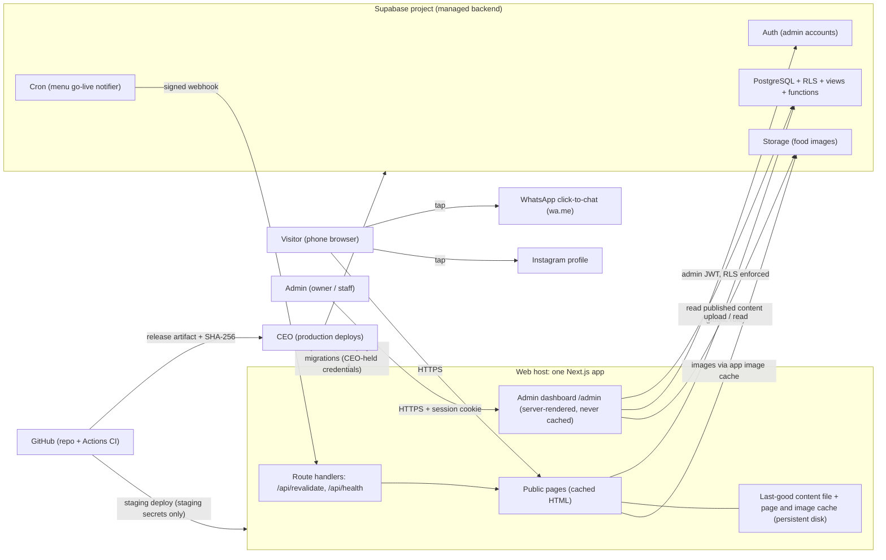

# Architecture — Tiffin Box website + admin dashboard
Version: v0.1 · Status: Draft for CEO review (Stage 0) · Owner: software-architect · Date: 2026-11-21
Based on: `docs/PRD.md` v0.2 (FR-01..FR-30, NFR-01..NFR-12), `docs/change-requests.md` (CR-001, CR-002, both still "Proposed").

Reading notes
- Nothing in this document is built, run or tested. It is a design. Items marked **[verify]** are assumptions about a platform's behaviour that must be proven in the Stage 2 spike (section 14, task T2.1) before we rely on them.
- Decisions are recorded in `docs/adr/0001`, `0002`, `0003` (all "Proposed" until the CEO approves Stage 0).
- Open client questions are not decided here. Where the design depends on one, the assumption is stated and the model is built to accept either answer (section 6.5).

## 1. Summary
One Next.js web application (public site + `/admin`) and one managed backend (Supabase: PostgreSQL, Auth, Storage). No separate API server.

- Public pages are server-rendered HTML, cached by the web app, and re-rendered when content is published. They read one "published content" document. If the backend is unreachable they render from the last good copy kept on the web host's disk (NFR-08).
- The admin dashboard runs in the same app under `/admin`. Every read and write goes through the server side of the app using the logged-in admin's own identity, and PostgreSQL row-level security (RLS) is the final gate on every table (NFR-07, NFR-12).
- Content editing is draft-first. "Publish" creates an immutable, versioned release in the database; rollback re-points to an earlier release. Publishing content is a data change by the client's staff, not a code deployment.
- Customer, subscription and payment records are saved immediately, never published, never cached, never reachable by the public role.
- Statuses that depend on today's date (expired, renewal due, unpaid, overdue) are computed when read, in one place (database views). No job has to run for them to be right.

## 2. System overview



Trust boundaries: (1) internet to web app; (2) web app to Supabase (public role vs authenticated admin); (3) GitHub/CI has staging access only; (4) production accounts are CEO-held.

## 3. Stack choice
Full reasoning and alternatives: ADR-0001 (stack/hosting), ADR-0002 (data store/auth), ADR-0003 (publishing/rendering).

| Layer | Choice | Why |
|---|---|---|
| Web framework | Next.js (App Router), React, TypeScript strict. Use the newest major that is in vendor support at Stage 2 start; pin exact versions in the lockfile | Official stack. Gives server-rendered HTML for SEO and speed (NFR-01, NFR-04), cached pages with on-demand refresh (NFR-06, NFR-08), and server-side admin code in the same project |
| Styling | CSS with brand tokens as CSS variables; Tailwind CSS only in a version whose browser floor matches NFR-10 (see section 13) | NFR-05 tokens; small CSS payload |
| Fonts | Space Grotesk + Inter self-hosted through the framework's font pipeline, Latin subset; no Urdu webfont (brand name is in the logo asset, A-05) | NFR-01, NFR-11 (no third-party font requests) |
| Backend | Supabase: PostgreSQL, Auth, Storage, Cron | Official stack. Relational data (customers, subscriptions, payments) with constraints and views; RLS enforces access at the database (NFR-12); one managed service instead of a server we operate |
| API server | None. No NestJS/Express service | Not needed: one team-internal client (our own web app), about 20 tables, no third-party consumers, no integrations. A separate API would add a second deployable, second set of secrets and roughly 8 to 12 working days for no user-visible benefit. Deviation from the "NestJS preferred for new backends" standard is justified in ADR-0001 |
| Vite | Not used | Next.js builds both the public site and the admin; a second toolchain is unnecessary |
| Validation | zod schemas in server actions + database check constraints | Input validated on the server and again by the database |
| Image processing | `sharp` on the server at upload (decode, re-encode, strip metadata); responsive variants by the framework image optimiser, cached on disk | FR-21, NFR-01, NFR-07 |
| Tests | Vitest (unit), pgTAP (RLS, views, functions), Playwright (E2E for journeys J1..J8), Lighthouse CI (NFR-01) | Coding standards |
| CI/CD | GitHub Actions: CI on PR, staging deploy from `develop`, release artifact + checksum from `release-*` tags. No production job | Template `deploy.yml`, production runbook |
| Hosting (web app) | **Recommended (in the official stack): Azure App Service, Linux, Basic B1, one instance, region close to the Supabase region.** Alternative that needs CEO/client approval (outside the official list): Vercel Pro. Rejected as primary: Firebase App Hosting, Azure Static Web Apps | ADR-0001 |
| Hosting (backend) | Supabase: production on the Pro plan in a CEO- or client-owned organisation; staging on the Free plan in a separate Createex organisation | Backups exist only on paid plans (verified on supabase.com/pricing, 2026-11-21) |

## 4. Repository and application structure
Single application at the repository root. No monorepo, no shared packages.

```
app/
  (public)/                 six pages + not-found + error; no auth, no Supabase client in the browser
  admin/
    login/                  A-01
    (dashboard)/            A-02..A-17, shared admin shell
    preview/                enable/disable preview (draft mode)
  api/
    revalidate/             POST, called by Supabase Cron and by the publish action
    health/                 GET, for uptime monitoring
src/
  content/                  public read path: fetch published content, last-good file, types
  admin/                    server actions grouped by area: content, menu, media, customers, subscriptions, payments, auth
  components/public/        header, nav, WhatsApp button, order button, footer, menu table, plan cards, FAQ
  components/admin/         forms, tables, filters
  lib/                      supabase server client, auth guard (requireAdmin), validation schemas, formatting (Rs, dates, Asia/Karachi)
  styles/                   tokens (NFR-05)
supabase/
  migrations/               every schema change, RLS policy, view, function, cron job (SQL, versioned)
  seed/                     synthetic customers/subscriptions/payments for local + staging; brief reference content (plans, dishes, menu) kept separate
  tests/                    pgTAP: RLS per role, status views, publish/rollback functions
tests/
  unit/  e2e/               Vitest, Playwright
docs/                       PRD, architecture, ADRs, api/openapi.yaml, playbook
```

Rules
- `app/(public)` must not import from `src/admin` and must not depend on a session. The auth middleware matches `/admin` only. This keeps the public site independent of admin failures (NFR-08).
- Business rules that decide money or status live in SQL (views/functions under `supabase/migrations`) and are tested with pgTAP. The UI displays them; it does not re-implement them.
- Static copy (Home benefits, story, how-it-works steps) lives in the code in v1 (A-16). If Q-15 says the owner must edit it, it becomes a keyed `page_copy` table that is added to the published content document; no other change.

## 5. Components

| Component | Responsibility | Notes |
|---|---|---|
| Public pages | Render S-01..S-07 from the published content document | Server components; client JavaScript only for the mobile nav toggle (FAQ uses native `details`/`summary`); WhatsApp and Instagram are plain links built from settings |
| Public content reader (`src/content`) | One call to the database function `get_public_content`; on success, save the result as the last-good file; on failure or timeout (3 s), return the last-good file | The only code path from public pages to the backend |
| Admin shell + auth guard | Session check in middleware for `/admin/*`; `requireAdmin()` at the top of every server action and admin page | Second layer; RLS is the third |
| Content editors (A-03..A-09) | CRUD on draft tables through server actions | Draft tables are admin-only |
| Preview & publish (A-10) | Preview via framework draft mode + draft content function; publish/rollback via database functions | Section 8 |
| Operations (A-12..A-17, A-02) | Customers, subscriptions, periods, payments, overview | Reads from status views; writes are immediate and audited |
| Change history (A-11) | Reads `audit_log` | Written by database triggers, append-only |
| Media pipeline | Signed upload to a private incoming bucket, server-side validation and re-encode, store sanitised master in the public media bucket | Section 8.5 |
| Route handlers | `/api/revalidate` (shared-secret webhook), `/api/health` | The only HTTP endpoints we write; see `docs/api/openapi.yaml` |
| Database | Tables, RLS policies, status views, publish/menu/payment functions, audit triggers, cron job | Section 6, 7, 9 |

## 6. Data model

### 6.1 ER diagram

```mermaid
erDiagram
  ADMIN_USERS ||--o{ AUDIT_LOG : "acts"
  ADMIN_USERS ||--o{ CONTENT_RELEASES : "publishes"
  SITE_STATE ||--|| CONTENT_RELEASES : "current release"
  MENU_WEEKS ||--|{ MENU_SLOTS : "has 21"
  MEDIA ||--o{ MENU_SLOTS : "optional photo"
  MEDIA ||--o{ DISHES : "optional photo"
  MEDIA ||--o{ PAGE_IMAGES : "fills slot"
  PLANS ||--o{ SUBSCRIPTIONS : "chosen plan"
  CUSTOMERS ||--o{ SUBSCRIPTIONS : "has"
  SUBSCRIPTIONS ||--|{ SUBSCRIPTION_PERIODS : "billed in"
  SUBSCRIPTIONS ||--o{ PAYMENTS : "paid by"
  CUSTOMERS ||--o{ PAYMENTS : "pays"
  SUBSCRIPTIONS ||--o| SUBSCRIPTIONS : "renewed from"

  ADMIN_USERS {
    uuid user_id PK "= auth user id"
    text display_name
    text role "owner or staff"
    bool is_active
  }
  SITE_SETTINGS {
    int id PK "single row"
    text whatsapp_number
    text instagram_handle
    text order_hours
    text delivery_area_text
    text delivery_times
    text skip_cutoffs
    int skips_per_week
  }
  PRICING_RULES {
    int id PK "single row"
    numeric monthly_saving_percent
    int breakfast_addon_price
    text team_deal_text
    int team_min_people
  }
  OPS_SETTINGS {
    int id PK "single row"
    int renewal_window_days
    int overdue_grace_days
    text monthly_period_rule
  }
  PLANS {
    uuid id PK
    text name
    text audience
    text meals_included
    text price_unit "per_meal or per_day"
    int unit_price
    int weekly_price
    int monthly_price "nullable override"
    bool is_most_popular
    bool is_active
    int sort_order
  }
  DISHES {
    uuid id PK
    text name
    text comes_with
    int price
    uuid media_id FK
    int sort_order
    bool is_hidden
  }
  ADDONS {
    uuid id PK
    text name
    int price
    int sort_order
    bool is_hidden
  }
  FAQ_ENTRIES {
    uuid id PK
    text question
    text answer
    int sort_order
    bool is_hidden
  }
  MEDIA {
    uuid id PK
    text storage_path
    text alt_text
    int width
    int height
    int bytes
    text checksum
    uuid uploaded_by
  }
  PAGE_IMAGES {
    text slot_key PK "home_hero, og_share"
    uuid media_id FK
  }
  MENU_WEEKS {
    uuid id PK
    date week_start "Monday, unique"
    timestamptz go_live_at "null = draft"
    jsonb live_payload
    timestamptz live_set_at
    uuid live_set_by
    timestamptz go_live_notified_at
  }
  MENU_SLOTS {
    uuid id PK
    uuid menu_week_id FK
    int day_of_week
    text meal "breakfast, lunch, dinner"
    text dish_text
    bool not_served
    uuid media_id FK
  }
  CONTENT_RELEASES {
    bigint id PK
    int version
    jsonb payload
    text checksum
    timestamptz published_at
    uuid published_by
    text note
  }
  SITE_STATE {
    int id PK "single row"
    bigint current_release_id FK
  }
  CUSTOMERS {
    uuid id PK
    text type "student, office, home"
    text name
    text phone_e164
    text address_text
    text org_name
    text contact_person
    int member_count
    text notes
    timestamptz archived_at
    timestamptz anonymised_at
  }
  SUBSCRIPTIONS {
    uuid id PK
    uuid customer_id FK
    uuid plan_id FK
    text plan_name_snapshot
    text term "weekly or monthly"
    date start_date
    date end_date
    bool breakfast_addon
    int amount_per_period
    text amount_note
    text manual_state "active or paused"
    date manual_state_on
    uuid renewed_from_id FK
    text notes
  }
  SUBSCRIPTION_PERIODS {
    uuid id PK
    uuid subscription_id FK
    date period_start
    date period_end
    int amount_due
    date due_date
    text note
  }
  PAYMENTS {
    uuid id PK
    uuid customer_id FK
    uuid subscription_id FK
    int amount "whole PKR, > 0"
    text method "jazzcash, easypaisa, bank_transfer"
    date paid_on
    date covers_from
    date covers_to
    text reference
    text note
    timestamptz voided_at
    text void_reason
    uuid recorded_by
  }
  AUDIT_LOG {
    bigint id PK
    timestamptz at
    uuid actor_user_id
    text actor_label
    text action
    text table_name
    text record_id
    jsonb old_values
    jsonb new_values
  }
```



### 6.2 Table list

Content (draft/working copy; edited in the dashboard, visible to visitors only after Publish)

| Table | Key fields | Notes |
|---|---|---|
| `site_settings` (1 row) | WhatsApp number (digits, international format), Instagram handle, order hours text, delivery-area text, three delivery times, three skip cut-offs, skips per week | FR-20. Publish is blocked while a required value is empty or still a brief placeholder (FR-10) |
| `pricing_rules` (1 row) | monthly saving %, breakfast add-on price per day, team-deal text, team minimum people | FR-16, FR-07 |
| `plans` | name, audience, meals included, price unit (per meal / per day), unit price, weekly price, optional monthly price, most-popular flag, active, order | FR-16. An active plan with an empty price blocks publish (covers Q-08). Monthly price: stored override if given, otherwise derived by the rule in `ops_settings` (Q-10) and shown to the admin before publish |
| `dishes` | name, comes-with, price, optional photo, order, hidden | FR-17 |
| `addons` | name, price, order, hidden | FR-18 |
| `faq_entries` | question, answer, order, hidden | FR-19, FR-11 |
| `media` | storage path of the sanitised master, alt text (required), dimensions, bytes, checksum, uploader | FR-21. "Where used" = lookups on `dishes`, `menu_slots`, `page_images` |
| `page_images` | slot key (`home_hero`, `og_share`), media id | Home photo and share image |
| `menu_weeks` | week start (Monday, unique), go-live time (null while draft), live snapshot (JSON of the 21 slots as released), who/when | FR-14, FR-15. Status is derived, section 8.3 |
| `menu_slots` | menu week, day 1..7, meal, dish text (length-limited), not-served flag, optional photo; unique per (week, day, meal) | Working copy of the 21 slots |

Publishing

| Table | Key fields | Notes |
|---|---|---|
| `content_releases` | version, payload (JSON: settings, pricing rules, active plans, visible dishes/add-ons/FAQ, page images), checksum, published at/by, note | Immutable. One row per publish. Enables rollback (NFR-08) and "what changed" (FR-23) |
| `site_state` (1 row) | current release id | What visitors see |

Operations (CR-002; saved immediately, never published)

| Table | Key fields | Notes |
|---|---|---|
| `customers` | type, name, phone (normalised to +92 form), address/hostel/office text, office fields (organisation, contact person, member count; required by a check constraint when type = office), notes, archived at, anonymised at | FR-24, FR-25. UUID keys so records cannot be guessed from a URL. Phone is indexed, not unique (duplicate = warning, FR-24) |
| `subscriptions` | customer, plan (+ plan name snapshot), term, start/end dates (check end >= start), breakfast add-on, amount per period (copied from the plan at creation, A-20), override note, manual state (active/paused) with date, renewed-from link, notes | FR-26. Status is derived, section 9 |
| `subscription_periods` | subscription, period start/end, amount due, due date, note | FR-29. At least one per subscription, created with it. See 6.5 for why this is a separate table |
| `payments` | customer, subscription, amount (whole PKR > 0), method, paid on, covers from/to, reference, note, void fields, recorded by | FR-28. Never deleted; "void" keeps the row. Index on (method, reference) for the duplicate warning |
| `ops_settings` (1 row) | renewal window days (default 7), overdue grace days (default 0), monthly period rule (`4_weeks` or `calendar_month`) | FR-27, FR-29. Takes effect immediately; not part of published content |

Access and audit

| Table | Key fields | Notes |
|---|---|---|
| `admin_users` | auth user id, display name, role (`owner`/`staff`), active | Who is an admin. A Supabase Auth account without an active row here can do nothing |
| `audit_log` | time, actor id and label, action, table, record id, old values, new values | FR-23. Written only by database triggers and by the publish/rollback/schedule functions. No update or delete is granted to anyone |

### 6.3 Conventions
- Money: integer whole PKR (NFR-09). Dates that are business dates (start, end, due, paid on) are `date`; instants are `timestamptz`. "Today" is always `now()` converted to Asia/Karachi.
- Text is UTF-8; names may be in Urdu script (NFR-09).
- Every schema change is a migration in `supabase/migrations`; no manual production edits.
- Searching customers by partial name, phone or organisation (FR-25) uses case-insensitive matching; at 1,000 customers this needs no special infrastructure. A trigram index can be added by migration if lists grow.

### 6.4 Sizing assumption
Under 1,000 customers, under 5 admins, under 10,000 site visits a month, under 200 images, database well under 100 MB (Q-36 will confirm). Every design choice here is comfortable at 10 times that.

### 6.5 Tolerance to open questions

| Question | v1 assumption (from PRD) | How the model accepts the other answer |
|---|---|---|
| Q-02 admin roles | One role, all admins equal (A-06) | `admin_users.role` exists from day one; all policies go through one `is_admin()` check. Restricting a "staff" role later means adding role-specific policies and hiding menu items, no table change. In-app admin user management is not in v1; accounts are created in the Supabase dashboard |
| Q-02 email reset | Not decided | Supabase Auth supports reset by email; turning it on needs a transactional email (SMTP) provider and one extra screen. Without it, a forgotten password is reset in the Supabase dashboard by the account owner (in production: the CEO or client owner) |
| Q-10 monthly period | Unresolved (A-21) | `ops_settings.monthly_period_rule` only pre-fills the proposed end date and amount; both are stored per subscription and editable. Switching the rule affects new subscriptions only |
| Q-28 skips/pauses | Manual pause only (A-23) | Manual state + date on the subscription. Skip tracking later = a new `subscription_skips` table and a function that extends `end_date`; existing tables unchanged |
| Q-32 grace days | 0 (A-22) | `ops_settings.overdue_grace_days` |
| Q-33 renewal window | 7 days (A-24) | `ops_settings.renewal_window_days` |
| Q-35 partial / multi-period payments | Allowed, shown as balance (A-25) | Payments are not tied one-to-one to a period. A subscription's payments are applied to its periods oldest first (section 9.2), so part payments and paying two periods at once both work. Discounts/waivers: edit a period's amount due with a note (audited) |
| Q-17 refunds | Not tracked | Later: add a `kind` column to `payments` (payment/refund), a non-breaking migration |
| Q-25 menu per plan | One menu for all plans | Later: add an optional plan reference or note per slot; snapshot format is versioned |
| Q-15 editable static copy | Developer-maintained (A-16) | Later: `page_copy` table added to the release payload |
| Q-29, Q-30, Q-31 invoices, receipts, delivery lists | Not in v1 | All can be generated from the same tables; no restructuring needed |
| Q-34 retention/deletion | Archive by default (A-26) | `anonymise_customer()` function replaces name, phone and address, keeps payment amounts for the books, and redacts that customer's values in `audit_log`. Retention period is a policy to be set; nothing is auto-deleted in v1 |
| Q-24 go-live time | Sunday evening, time unknown | `go_live_at` is a full timestamp chosen per week; a default time is a setting |

## 7. Authentication and authorisation (admins)

Identity
- Supabase Auth, email + password. Public sign-up is disabled in the project. Admin accounts are created by the project owner in the Supabase dashboard (production: by the CEO or the client's owner, per Q-03) and a matching `admin_users` row is added.
- Passwords are hashed by Supabase Auth (bcrypt) and never pass through our logs. Minimum length and leaked-password checking are set in the Auth settings (leaked-password protection is a Pro-plan feature).
- Optional and recommended for the owner account: app-based two-factor (TOTP), which Supabase Auth supports. Not in the PRD; CEO/client decision.

Session
- The session lives in secure, `SameSite=Lax`, HTTP-only cookies handled on the server. The browser never talks to Supabase directly, so no Supabase key or token is needed in client JavaScript.
- Idle timeout (FR-13): enforced in the `/admin` middleware with a last-activity timestamp; default 30 minutes, absolute lifetime 12 hours (both configurable; to be confirmed with the client). Logout revokes the refresh token.
- Password change (FR-13): requires the current password, then updates through Supabase Auth.

Three layers of authorisation, all server-side
1. Middleware on `/admin/*`: no valid session = redirect to login. Admin and preview responses carry `noindex` and `no-store`.
2. `requireAdmin()` in every admin page and server action: verifies the session with Supabase Auth (not just the cookie) and that the user is an active admin.
3. PostgreSQL RLS on every table, which holds even if layers 1 and 2 have a bug:

| Data | Public role (`anon`) | Authenticated admin | Anyone else |
|---|---|---|---|
| Published content | Execute `get_public_content()` only. No table grants at all | Read | None |
| Draft content, media rows, menu weeks/slots | None | Read/write | None |
| Customers, subscriptions, periods, payments, ops settings | None | Read/write (payments: insert/update, no delete) | None |
| `audit_log` | None | Read only | None |
| `admin_users` | None | Read own row (v1) | None |
| Storage: `media` bucket | Read objects (food photos only) | Write | None |
| Storage: `media-incoming` bucket | None | Write/read own uploads | None |

Other controls (NFR-07)
- Login throttling: Supabase Auth's built-in rate limits are the control that cannot be bypassed (the Auth endpoint is reachable directly). In addition the login server action counts failures per account and address and delays/refuses after repeated failures, with a generic error message.
- CSRF: mutations are server actions (origin-checked by the framework) with `SameSite` cookies; the two route handlers use a shared secret / are read-only.
- XSS: React escaping, no raw HTML rendering of admin-entered text, Content-Security-Policy header, input length and character validation (FR-14).
- The Supabase service-role key (which bypasses RLS) is not used by the application at runtime. It stays in the Supabase dashboard of whoever owns the project.
- Secrets (revalidation secret, Supabase keys) come from the host's environment settings; only `.env.example` is committed.
- Personal data never appears in URLs, logs or error messages: record URLs use UUIDs; customer search text is sent in the request body, not the query string; logs record ids and actions only.

## 8. Publishing, preview and scheduled menu go-live
Decision record: ADR-0003.

### 8.1 Publish (FR-22)
1. Editors save to draft tables. Visitors are unaffected.
2. "Unpublished changes" indicator: the database assembles the would-be payload from the draft tables and compares its checksum with the current release's checksum. No dirty flags to get out of sync.
3. Publish calls the database function `publish_content(note)`. In one transaction it: checks the caller is an admin; validates (required settings present and not placeholders, every active plan has prices, alt text present); writes a new `content_releases` row; points `site_state` at it; writes an audit entry. If anything fails, nothing changes and the live site stays on the previous release (FR-22).
4. The server action then refreshes the cached public pages (on-demand revalidation) and fetches them once to confirm the new version is being served, and reports success or failure to the admin. Expected visibility: seconds; guaranteed backstop: within about a minute because public pages also re-check on a 60-second timer (NFR-06).
5. Rollback (NFR-08): `rollback_release(version)` re-points `site_state` to an earlier release, audited, then the same cache refresh. The draft tables are not changed by a rollback.

### 8.2 Preview (FR-22)
- "Preview" switches the admin's browser into the framework's draft mode. The same public page components then render from `get_draft_content()` (admin-only) instead of the published document, with a visible "Preview" banner, `noindex`, and no caching.
- The draft-mode cookie alone gives nothing: the draft data is fetched with the admin's session and RLS refuses anyone else.
- Menu preview shows the selected week's working slots.

### 8.3 Menu weeks: draft, scheduled, published (FR-14, FR-15, FR-06)
- A menu week has working slots (`menu_slots`) and, once released, a live snapshot (`live_payload`) with a go-live time (`go_live_at`).
- Status is derived, never stored as a time-dependent flag:

| Derived status | Condition |
|---|---|
| Draft | no go-live time |
| Scheduled | go-live time in the future |
| Published (live) | the week with the latest go-live time that is not in the future |
| Past | released earlier and superseded |

- "Publish now" = snapshot + go-live time of now. "Schedule" = snapshot + future go-live time (default: next Sunday at the configured time, Q-24). Saving edits to a scheduled week updates its snapshot in the same action; "Cancel schedule" clears it (back to Draft). The live menu is untouched in all three cases (FR-15).
- Editing the week that is live changes only the working slots until the admin publishes again (FR-14 "save as draft").
- "Copy last week" copies the 21 slots into a new draft week.
- What visitors see: `get_public_content()` returns the Published week by the rule above. Because the rule compares against the current time, a scheduled menu becomes the live menu at its go-live time with no job having to run. If no week covers the current calendar week, the most recent published one is returned with its date so the page can show "last updated" (FR-06).

### 8.4 Making the scheduled menu appear on time
The data is correct at go-live by definition; the cached page must also refresh. Two mechanisms:
1. Notifier (primary): a Supabase Cron job runs every minute; if a week's go-live time has passed and it has not been announced, it calls the app's `/api/revalidate` with a shared secret and marks the week announced. **[verify]** pg_cron + pg_net availability and reliability on the chosen plan.
2. Backstop: public pages re-check their content every 60 seconds when visited. If the notifier fails, the first visitor after go-live may see the old menu once; the next request gets the new one.

### 8.5 Images (FR-21)
1. The admin's browser uploads the original to the private `media-incoming` bucket using a short-lived signed upload URL issued by a server action (keeps large files off the web host's request-size limits).
2. A server action downloads it, checks type by decoding it (JPG/PNG/WebP only), enforces limits (**8 MB, longest side 6000 px**), re-encodes to a sanitised master (longest side 2000 px), which strips EXIF/GPS metadata, stores it under a content-hash name in the public `media` bucket, records the `media` row (alt text required) and deletes the original.
3. Public pages serve images through the framework's image optimiser: responsive sizes, WebP/AVIF, lazy loading, cached on the host's disk with a long lifetime (names are content-hashed so they never change).
4. Deleting an image that is referenced returns the list of places it is used and asks for confirmation.

## 9. Computed statuses (FR-27, FR-29, FR-30)
Computed on read in database views. One definition each, used by the lists, the customer detail, the filters and the overview, so the overview counts always match the lists (FR-30). No scheduled job, so nothing can be "stale because the job did not run". At this data size the cost is negligible.

`today` = current date in Asia/Karachi.

### 9.1 Subscription status (view `subscription_status`)

| Result | Rule (first match wins) |
|---|---|
| Paused | manual state is paused |
| Expired | end date < today |
| Upcoming | start date > today |
| Active | otherwise |

Renewal due / expiring = Active and (end date - today) <= `renewal_window_days`.

Two points go beyond the PRD wording and are flagged for the PM (section 15): the PRD does not say which wins when a paused subscription passes its end date, and it has no name for a subscription that starts in the future. The order above is a proposal; it is one line in one view to change.

### 9.2 Payment status per period (view `period_payment_status`)
- A subscription's non-voided payments are totalled and applied to its periods in date order, oldest first. Paid amount of a period = the part of that total that reaches it.
- Paid: paid amount >= amount due. Overdue: not fully paid and today > due date + grace days. Unpaid: not fully paid and not overdue. Balance = amount due - paid amount.
- Due date defaults to the day before the period starts (payment in advance, A-22) and is editable.
- Customer-level payment status (filter in FR-25) = the worst status among that customer's periods (overdue, then unpaid, then paid). Offices are one customer record, so their dues are tracked on that record (A-19).
- The "covers from/to" dates typed on a payment are kept as entered for the record; allocation follows the oldest-first rule. This is a proposal tied to Q-35.

### 9.3 Overview (view `dashboard_overview`)
Active subscribers (distinct customers with an Active subscription; office head-count shown separately), count and total of Unpaid and of Overdue periods, count of subscriptions with renewal due. Each card links to the list with the same filter.

### 9.4 Periods
A subscription is created with one period covering start to end. "Renew" creates a new subscription starting the day after (FR-26). If the client turns out to run long subscriptions billed weekly or monthly (Q-10, Q-35), more periods are added to the same subscription; the status logic is unchanged.

## 10. Environments, deployment and backups

| | Local | Staging | Production |
|---|---|---|---|
| Web app | `next dev` on the developer machine | Azure App Service (Createex-controlled subscription); deployed by GitHub Actions on push to `develop` using staging-only secrets | Azure App Service B1 Linux in a CEO- or client-owned subscription (Q-03); deployed by the CEO from the release artifact |
| Backend | Supabase CLI local stack (Docker) | Supabase project in a Createex organisation, Free plan | Separate Supabase organisation and project, Pro plan, owned by CEO or client |
| Data | Synthetic seed only | Synthetic seed only; never a copy of production (NFR-12) | Real content and real customer data |
| Access | Developer | Operator + agents (staging roles only) | CEO only (Option B). Client staff use the admin dashboard, not the cloud consoles |
| Visibility | localhost | `noindex` + HTTP basic auth | Public site; `/admin` not linked, `noindex` |
| Secrets | `.env.local` (git-ignored), local keys | GitHub Actions secrets (staging only) + staging host settings | CEO's vault + production host settings. None in GitHub |

Deploy flow (fits `docs/playbook/production-release-runbook.md`)
- The build artifact contains no environment-specific values and no content: all configuration is read from the host's environment at runtime, and public pages are rendered at runtime, not baked at build. Therefore the exact artifact tested on staging is the one the CEO deploys, and its SHA-256 in the release PR is meaningful. **[verify]** in the Stage 2 spike that public pages are not pre-rendered with content at build on the chosen framework version.
- CI (pull requests): lint, typecheck, unit tests, database tests against a throwaway local Supabase, build.
- Staging: push to `develop` runs migrations against staging and deploys.
- Release: tag `release-vX.Y.Z` builds the artifact and checksum. CEO approves the release PR; then, on a machine without agents: confirm backup, apply migrations to production, deploy the artifact, run the smoke test (six pages return 200, health endpoint, admin login page loads, a test revalidation succeeds), or roll back by redeploying the previous artifact.
- Migrations are written to be backward compatible with the previous app version (add first, remove in a later release) so an app rollback does not need a database rollback; each migration still ships with a rollback script.
- GitHub branch protection is not available on the Free plan and nothing here relies on it. A merge to `main` cannot reach production because no production credential exists in GitHub.
- Content publishing by the client's admins (menu, prices) is normal operation through the dashboard and is not a deployment; it needs no CEO action.

Backups and restore (NFR-08, NFR-12)
- Database: Supabase Pro daily backups, kept 7 days (verified on supabase.com/pricing, 2026-11-21). Recovery point: up to 24 hours of staff-entered records could be lost in a total database loss. Point-in-time recovery is a USD 100/month add-on and is not recommended at this size.
- Off-platform copy: a monthly encrypted database dump taken by the CEO (production credentials) and kept in the CEO's vault storage, so a lost Supabase account is not a total loss. Proposed; CEO to confirm.
- Images: Supabase database backups do not include stored files **[verify]**. Risk is low (the client owns the original photos; masters are small); the monthly CEO backup includes a copy of the `media` bucket.
- Restore test: the procedure is rehearsed on staging with synthetic data at Stage 5. A restore test of a real production backup is done by the CEO into a temporary CEO-owned project, checked and deleted; real data never goes to staging.
- Content rollback: section 8.1. Backups are protected like live data (same account, CEO-only).

Monitoring
- Uptime check on the home page and `/api/health` every 5 minutes with an alert to the operator and CEO; host and Supabase logs; structured application logs without personal data. Tool choice at Stage 5 (section 11).

## 11. Third-party dependencies

| Dependency | Use | Status |
|---|---|---|
| Supabase | Database, auth, storage, cron | Official stack. Paid plan for production needs budget approval (Q-03) |
| Azure App Service | Web hosting | Official stack. Subscription owner and budget needed (Q-03) |
| GitHub + Actions | Repo, CI, staging deploy, release artifact | In place (Free plan; 2,000 private Actions minutes a month is ample) |
| WhatsApp `wa.me` links, Instagram link | Plain links; no API, no SDK, no embed | No account or key needed. Number pending (Q-04) |
| Domain registrar / DNS | Custom domain + TLS certificate on the host | Client/CEO (Q-05). DNS changes by the CEO |
| Transactional email (SMTP) provider | Only if password reset by email is wanted (Q-02) | Not selected; needs CEO approval. Supabase's built-in mailer is for testing only |
| Uptime monitor / error tracking | Monitoring | Not selected. Start with a free uptime monitor and host logs; any external service needs CEO approval |
| Analytics | Only if approved (Q-22, NFR-11) | None by default; no cookies, no third-party scripts |
| Key npm packages | `next`, `react`, `@supabase/supabase-js`, `@supabase/ssr`, `zod`, `sharp`; dev: `vitest`, `playwright`, `eslint`, `prettier`, Supabase CLI | Each justified above; pinned by lockfile; `npm audit` every stage |

## 12. Hosting cost estimate (per month, USD list prices)
Scale assumed: section 6.4. Prices marked "verified" were read from the vendor's pricing page on 2026-11-21; others are the architect's recollection and must be re-checked by devops-engineer before the CEO quotes the client. Convert to PKR at the day's rate.

Recommended (meets all NFRs as designed)

| Item | Plan | Cost |
|---|---|---|
| Supabase production | Pro, one small project. "From $25/month", includes $10 compute credit that covers one Micro instance (verified) | 25 |
| Azure App Service production | Linux Basic B1, 1 core, 1.75 GB RAM, 10 GB storage (specs verified; price not shown on the page in this session; recollection about USD 13) | about 13, unverified |
| Domain | .com or .pk, paid yearly | about 1 to 2, unverified |
| Supabase staging | Free plan in a separate organisation (verified limits: 500 MB database, 1 GB files, 2 projects, paused after 1 week without activity) | 0 |
| Azure staging | Free F1 for routine checks (60 CPU-minutes a day; no TLS on custom domains, the default azurewebsites.net address is fine); a second B1 for the weeks of Stage 4 performance testing | 0, or about 13 in the test month |
| Email, monitoring | Free tiers, only if approved | 0 |
| **Total production** | | **about USD 39 to 40 a month** |

Variants for the CEO

| Variant | Monthly | Trade-off |
|---|---|---|
| A. Recommended: Supabase Pro + Azure B1 | about 39 to 40 | In the official stack; automatic backups |
| B. Supabase Pro + Vercel Pro ($20/month, verified; seat pricing to confirm) | about 46 to 47 | Outside the official hosting list: needs CEO/client approval. Less operations work, global CDN. See ADR-0001 |
| C. Lowest cost: Supabase Free + Azure B1 | about 14 to 15 | **Does not meet NFR-08 as written**: no automatic backups on the Free plan (verified) and the project is paused after a week without activity (verified). Only acceptable with a written CEO/client risk acceptance and a manual backup routine |
| D. No admin (neither CR approved) | about 0 to 15 | Site content lives in the code; a static host is enough; no Supabase. Every menu or price change is a developer change and a CEO production deploy |

Not included: Createex support/maintenance time, PITR, extra staging month, any paid email/monitoring tier.

## 13. Platform feasibility

| Platform | Feasibility | Notes |
|---|---|---|
| Web, mobile browsers (primary) | Feasible | Server-rendered HTML, very little JavaScript on public pages; WhatsApp and Instagram are ordinary links that work without JavaScript |
| Web, desktop browsers | Feasible | Same pages; `wa.me` opens WhatsApp Web/landing page (FR-02) |
| Admin on phone and desktop | Feasible | Responsive admin; data tables scroll inside their container (NFR-02) |
| Android app / iOS app | Not applicable | Out of scope; Stage 6 store publishing is not applicable |

Browser floor (NFR-10) needs a decision. The PRD proposes Safari on iOS 15+. Current framework majors raise the minimum to about Safari 16.4 / Chrome 111 (architect's recollection of the Next.js 16 and Tailwind CSS 4 support tables; **[verify]** at Stage 2 start), and the older Next.js major that supported older Safari is at or past the end of its security support window by now. Options: (a) change NFR-10 to iOS 16.4+ and treat older iPhones as best-effort (content readable, WhatsApp link works); (b) keep iOS 15 and accept an out-of-support framework version, which is not recommended. Android: Chrome no longer updates on Android 8 and 9 (recollection, **[verify]**), so "last 2 versions" there means the last version those phones received; this is above the framework floor and is not a problem.

Performance feasibility (NFR-01): achievable in principle (small HTML and CSS, self-hosted subset fonts, one optimised hero image, no third-party scripts). Not guaranteed by design alone: the hero image must be about 100 KB or less at phone width, and Azure has no region in Pakistan and option A has no CDN edge, so first-byte time from Lahore must be measured on staging at Stage 2 and again at Stage 4. If it misses the target, the fallback is a CDN in front of the app (a hosting change that would need approval).

## 14. NFR approach

| NFR | Approach |
|---|---|
| NFR-01 | Cached server-rendered pages; minimal client JavaScript; image optimiser with responsive sizes and lazy loading; hero image prioritised; self-hosted fonts; no third-party scripts; performance budget enforced in CI with Lighthouse CI; admin lists paginated on the server |
| NFR-02 | Mobile-first CSS at 360 px; Playwright checks at 360/390/768/1280 |
| NFR-03 | Semantic HTML, native `details` for FAQ, focus styles, `lang` attributes, required alt text in the data model; automated axe checks plus manual keyboard pass; contrast fixed in Stage 1 tokens |
| NFR-04 | Server-rendered HTML, per-page metadata, sitemap and robots generated by the app, canonical URLs, structured data from settings, Open Graph image from `page_images`; `noindex` on admin, preview and staging |
| NFR-05 | Tokens as CSS variables; fonts as in section 3 |
| NFR-06 | On-demand refresh at publish; 60-second timed re-check as backstop; cron notifier for scheduled menus |
| NFR-07 | Section 7; upload validation section 8.5; dependency audit in CI; security review at Stage 4 |
| NFR-08 | Public pages served from the app's cache; last-good content file on persistent disk when the backend is down; public route group has no dependency on auth or admin code; daily backups + monthly off-platform copy + rehearsed restore; release rollback |
| NFR-09 | UTF-8; integer PKR; one formatting module for "Rs 4,200", 12-hour times and Asia/Karachi dates |
| NFR-10 | Section 13; Playwright runs Chromium and WebKit; human real-device checks at Stage 4 |
| NFR-11 | No forms, no cookies, no analytics, no third-party requests on public pages |
| NFR-12 | RLS on every table with default deny; public role can execute one function; no service-role key at runtime; provider encryption in transit and at rest; UUIDs in URLs; no personal data in logs; synthetic data outside production; audit triggers; archive + anonymise function; backups CEO-only |

Known limit on NFR-08: when Supabase is down, text content, prices, menu and the WhatsApp button keep working. Images already in the app's image cache keep working; an image never requested before the outage shows its alt text until Supabase returns.

## 15. Architectural home of every requirement

| Req | Component(s) |
|---|---|
| FR-01 | Public layout: header + nav component |
| FR-02 | Public layout: persistent WhatsApp button; number from published `site_settings` |
| FR-03 | Public layout: end-of-page order button component |
| FR-04 | Public layout/footer: Instagram link from published `site_settings` |
| FR-05 | Home page; static copy in code; lowest active plan price and `home_hero` image from the published document |
| FR-06 | Menu page; live menu week selected by `get_public_content()` (section 8.3) |
| FR-07 | Plans & Pricing page; `plans`, `pricing_rules` in the published document |
| FR-08 | Customize page; `dishes`, `addons` in the published document |
| FR-09 | How it works page; static steps in code; times, cut-offs and skip count from published `site_settings` |
| FR-10 | About & Contact page; `site_settings`; publish validation blocks placeholders |
| FR-11 | FAQ component (native `details`); `faq_entries` in the published document |
| FR-12 | App `not-found` and `error` pages; last-good content file for the readable fallback |
| FR-13 | Supabase Auth; `/admin` middleware; `requireAdmin()`; login/logout/password server actions; idle timeout; `admin_users` |
| FR-14 | Menu editor; `menu_weeks`, `menu_slots`; menu server actions |
| FR-15 | Menu release function (snapshot + `go_live_at`); derived status; cron notifier + `/api/revalidate` |
| FR-16 | Plans editor; `plans`, `pricing_rules`; check constraints; computed monthly price display |
| FR-17 | Dishes manager; `dishes` |
| FR-18 | Add-ons manager; `addons` |
| FR-19 | FAQ manager; `faq_entries` |
| FR-20 | Settings screen; `site_settings` (published) and `ops_settings` (immediate) |
| FR-21 | Media pipeline (section 8.5); `media`, `page_images`; Storage buckets |
| FR-22 | Preview (draft mode + `get_draft_content()`); `publish_content()` / `rollback_release()`; `content_releases`, `site_state`; cache refresh |
| FR-23 | Audit triggers and `audit_log`; Change history screen; release payloads for "what changed" in content |
| FR-24 | Customer form and actions; `customers` with constraints; archive; `anonymise_customer()` |
| FR-25 | Customers list/detail; server-side search and filters over `customers` joined to status views |
| FR-26 | Subscription form and functions (create with first period, renew); `subscriptions`, `subscription_periods` |
| FR-27 | View `subscription_status`; `ops_settings.renewal_window_days` |
| FR-28 | Payment form and actions (record, edit, void); `payments`; duplicate-reference check |
| FR-29 | View `period_payment_status`; payments list with filters and totals; `ops_settings.overdue_grace_days` |
| FR-30 | View `dashboard_overview`; dashboard home |
| NFR-01 | Public rendering + caching, image optimiser, font pipeline, Lighthouse CI; server-side pagination in admin |
| NFR-02 | Public and admin layouts/CSS; Playwright viewport tests |
| NFR-03 | Public components, design tokens, `media.alt_text` required; axe tests |
| NFR-04 | Public pages metadata, sitemap/robots routes, structured data, `og_share` image |
| NFR-05 | `src/styles` tokens, font pipeline |
| NFR-06 | Publish action cache refresh, `/api/revalidate`, 60-second timed re-check |
| NFR-07 | Supabase Auth, middleware, `requireAdmin()`, RLS, CSP/security headers, media validation, CI audit |
| NFR-08 | Page cache + last-good content file, route separation, Supabase backups, release rollback, runbook rollback |
| NFR-09 | `src/lib` formatting module, integer PKR columns, Asia/Karachi "today" in views |
| NFR-10 | Build targets/browserslist, Playwright browsers, Stage 4 device tests |
| NFR-11 | Public route group (no forms, cookies, analytics) |
| NFR-12 | RLS, single public function, audit triggers, anonymise function, environment separation, seed data policy, backup policy |

## 16. Risks and mitigations

Technical

| # | Risk | Likelihood / impact | Mitigation |
|---|---|---|---|
| T1 | Page caching on the chosen host does not behave as assumed (cache lost on restart, refresh not immediate, pages baked at build) | Medium / Medium | Stage 2 spike T2.1 on a staging App Service before feature work; the last-good-file fallback does not depend on cache behaviour; Vercel is the documented alternative |
| T2 | NFR-01 missed because of image weight or first-byte time from Lahore without a CDN | Medium / Medium | Performance budget in CI from the first page; measure from a real phone on a Pakistani mobile network in Stage 2; CDN as a fallback decision |
| T3 | Payment/overdue logic does not match how the owner actually bills (Q-10, Q-32, Q-35) | High / Medium | Rules isolated in two views and three settings; database tests written from PRD acceptance criteria; confirm rules with the client before Stage 3 starts |
| T4 | Scheduled menu does not appear on time (cron or webhook failure) | Low / Medium | Go-live is correct in data regardless; 60-second backstop; overview shows the scheduled menu and whether it is live; "Publish now" always available |
| T5 | NFR-10 iOS 15 conflicts with supported framework versions | High / Low | CEO/PM decision on the browser floor (section 13) |
| T6 | Supabase platform change or outage | Low / Medium | Public site survives outages; standard Postgres + SQL migrations keep the data portable |

Security

| # | Risk | Likelihood / impact | Mitigation |
|---|---|---|---|
| S1 | Customer/payment data exposed through a missing or wrong RLS policy | Low / High | Default deny; public role has no table grants; database tests assert every table is unreadable as `anon` and as a non-admin user, run in CI; security-engineer review at Stage 3 and Stage 4 |
| S2 | Admin account takeover (weak or shared password, phone left unlocked) | Medium / High | Rate limits, leaked-password check, idle timeout, one account per person, optional two-factor for the owner, audit log shows who did what |
| S3 | Real customer data ends up in staging, a developer machine or a chat | Low / High | Synthetic seeds only; no production access for the team; restore tests by the CEO in a temporary project |
| S4 | Malicious or oversized upload | Low / Medium | Decode-and-re-encode pipeline, limits, private incoming bucket, admin-only |
| S5 | Legal duties for personal data in Pakistan not assessed (Q-34) | Unknown / Medium | CEO/client to confirm; anonymise and archive functions and a retention setting point are in the design |
| S6 | Lost password with a single admin and no email reset | Medium / Medium | Decide Q-02; recommend email reset in v1 or a second owner account |

Delivery

| # | Risk | Likelihood / impact | Mitigation |
|---|---|---|---|
| D1 | The client has not confirmed the admin dashboard at all (Q-01); CR-001 and CR-002 are about 70 percent of the effort | High / High | CEO decision on both CRs before Stage 1 starts; milestones below are separable (public site, content admin, operations) |
| D2 | Client inputs late: logo, photos, prices, WhatsApp number, domain (Q-04..Q-14) | High / Medium | Marked placeholders through Stage 2; publish validation blocks placeholders; launch checklist |
| D3 | Hosting owner and budget unknown (Q-03); production accounts must exist before Stage 5 | High / Medium | CEO decision at this gate; staging can start on Createex accounts |
| D4 | Production deploys and migrations are manual by the CEO | Medium / Medium | One checksummed artifact, short runbook, rehearsal on staging, backward-compatible migrations |
| D5 | Scope growth from open questions (skips, invoices, receipts, delivery lists, roles) | Medium / Medium | Each is a change request; the model shows where each would attach (section 6.5) |
| D6 | No branch protection on GitHub Free | Certain / Low | Nothing depends on it; weekly `verify-approval.sh --audit`; no production credentials in GitHub |

## 17. Milestones and tasks for the orchestrator
Effort and ranges are in `docs/PRD.md` section 12. Task ids are for dependency tracking. "Blocks" lists what cannot start before the task is done.

| Id | Task | Owner agent | Depends on | Blocks |
|---|---|---|---|---|
| T0.1 | CEO decisions: CR-001, CR-002, hosting option, Supabase plan, browser floor | CEO | Stage 0 package | Everything |
| T1.1 | Design system and tokens (contrast-checked), public screens S-01..S-07 with states | uiux-designer | T0.1, Q-12, Q-18 | T2.2 |
| T1.2 | Admin content screens A-01..A-11 | uiux-designer | T0.1 (CR-001), Q-15 | T2.4 |
| T1.3 | Admin operations screens A-12..A-17 | uiux-designer | T0.1 (CR-002), Q-02, Q-28, Q-29, Q-31 | T2.5 |
| T2.1 | Spike: app skeleton on staging host; prove page caching, restart persistence, on-demand refresh, last-good fallback, no content baked at build; first-byte time from Lahore | web-frontend-developer + devops-engineer | T0.1 | T2.2, T3.3 |
| T2.2 | CI (lint, typecheck, tests, Lighthouse budget), staging deploy pipeline | devops-engineer | T2.1 | T2.3 |
| T2.3 | Public pages with labelled mock content; SEO; accessibility | web-frontend-developer | T1.1, T2.2 | T3.3 |
| T2.4 | Admin shell and content screens with mocks | web-frontend-developer | T1.2, T2.2 | T3.2 |
| T2.5 | Operations screens with mocks | web-frontend-developer | T1.3, T2.4 | T3.5 |
| T3.1 | Schema migrations, RLS, audit triggers, seeds, database tests (content + access) | database-engineer | T0.1; can start in parallel with Stage 2 only after the Stage 1 gate | T3.2, T3.4 |
| T3.2 | Auth, guard, content server actions, media pipeline | backend-developer | T3.1, T2.4 | T3.3 |
| T3.3 | Publish, preview, rollback, menu scheduling, cron notifier, public read path on real data | backend-developer | T3.2, T2.3 | T4.1 |
| T3.4 | Operations schema: customers, subscriptions, periods, payments, status views, tests | database-engineer | T3.1; rules for Q-10, Q-32, Q-35 | T3.5 |
| T3.5 | Operations server actions and screens on real data; overview | backend-developer | T3.4, T2.5 | T4.1 |
| T3.6 | RLS and auth review | security-engineer | T3.3, T3.5 | T4.1 |
| T4.1 | E2E for J1..J8, regression, responsive, performance, accessibility, real-device notes | qa-engineer | T3.3, T3.5 | T4.3 |
| T4.2 | Security review (personal data, uploads, headers, dependencies) | security-engineer | T3.6 | T4.3 |
| T4.3 | Fixes, retest, release candidate | developers + qa-engineer | T4.1, T4.2 | T5.1 |
| T5.1 | Production environment definition, runbook specifics in `docs/deployments.md`, backup and restore rehearsal on staging, monitoring | devops-engineer | T4.3; production accounts (Q-03), domain (Q-05) | T5.2 |
| T5.2 | Production deploy, migrations, DNS, first admin account, smoke test | CEO (operator guides) | T5.1, approved release PR | Launch |

## 18. Follow-ups outside this document
- `docs/api/openapi.yaml`: outline of the real HTTP surface (two route handlers and the database functions).
- Project `CLAUDE.md` "Stack: pending" line and `docs/deployments.md` environment table should be filled by the orchestrator/devops-engineer after the CEO approves this stage; not edited here.
- `docs/traceability.md` "API endpoints" column can be filled from section 15 by requirements-pm.
