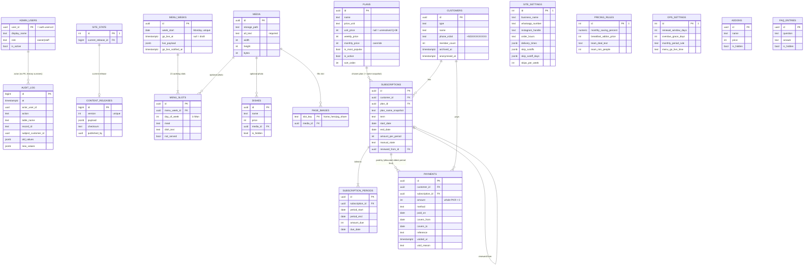

# Database (Stage 3: T3.1 schema, access rules, functions; T3.4 operations schema, status views)

Status 2026-11-22: **written and tested against a throwaway local PostgreSQL 16 database with a local emulation of the Supabase pieces. Never run against Supabase** (no Supabase project exists, no Docker). Evidence: `docs/test-results/stage3/`. Not verified by a human. Not reviewed by security-engineer yet (T3.6).

Decisions: ADR-0002 (Supabase PostgreSQL + RLS), ADR-0003 (draft tables, immutable releases, computed statuses). Design: `docs/architecture.md` sections 6 to 10. Where this file and the architecture differ, section 10 below lists every difference.

## 1. Files

| Path | What |
|---|---|
| `supabase/migrations/2026112200000N_*.sql` (11 files) | Versioned schema: tables, constraints, indexes, RLS and grants, audit, status views, publishing, menu and operations functions, storage policies, final lockdown |
| `supabase/rollbacks/*.down.sql` | One rollback script per migration (applied in reverse order; destructive, see section 8) |
| `supabase/seed/01_reference_content.sql` | Brief reference content (plans, dishes, add-ons, FAQ, settings with placeholders, sample menu week). Draft only, no personal data |
| `supabase/seed/02_synthetic_staging.sql` | SYNTHETIC customers, subscriptions, payments, one release, two menu weeks. Local and staging only; refuses to run if a non-synthetic customer exists |
| `supabase/ops/menu_go_live_cron.sql` | OPTIONAL pg_cron + pg_net go-live notifier. Not a migration, **untested** (section 9) |
| `supabase/tests/` | `local-shim.sql` (Supabase emulation, test-only), `helpers.sql`, `fixtures.sql`, `data.sql`, test files `01_..07_*.sql`, `run.sh`, `rollback_cycle.sh`, `backup_restore_test.sh`, `perf_explain.sql` |
| `npm run db:test` | Runs `supabase/tests/run.sh` |

## 2. ER diagram (as built)



Views (read models, all `security_invoker`): `subscription_status`, `period_payment_status`, `subscription_balance`, `customer_summary`, `menu_week_status`, `dashboard_overview`, `change_history`.

## 3. Access rules (RLS) per table

RLS is **enabled on all 19 tables**. `anon` has **no grant of any kind** on any table, view or sequence, and may execute exactly one function: `public.get_public_content()`. No policy names `anon`. Every policy for `authenticated` requires `app.is_admin()` (an active row in `admin_users`), so a signed-in user who is not an active admin sees and changes nothing. The service-role key is not used anywhere. All of this is asserted from the catalogue and by behaviour in `tests/01_rls.sql`.

| Table | anon | Active admin | Other signed-in user / inactive admin |
|---|---|---|---|
| `admin_users` | none | read own row only; no writes (accounts are created in the Supabase dashboard) | read own row only (so the app can see `is_active = false`) |
| `site_settings`, `pricing_rules`, `ops_settings` | none | read, update (rows are created by the migration) | none |
| `plans`, `dishes`, `addons`, `faq_entries`, `media`, `page_images` | none | read, insert, update, delete | none |
| `menu_weeks`, `menu_slots` | none | **read only**; written by `save_menu_week`, `copy_menu_week`, `release_menu_week` | none |
| `content_releases`, `site_state` | none | **read only**; written by `publish_content`, `rollback_release`. Releases are immutable (trigger) | none |
| `customers` | none | read, insert, update (listed columns; `anonymised_at` only via function). **No delete** | none |
| `subscriptions` | none | read, update (listed columns; `customer_id` fixed). Created only by `create_subscription`. **No delete** | none |
| `subscription_periods` | none | read, insert, update. **No delete** | none |
| `payments` | none | read, insert, update of editable columns on non-voided rows. Void only via `void_payment`. **No delete** | none |
| `audit_log` | none | read only. Append-only: no INSERT/UPDATE/DELETE grant for anyone, plus a trigger that blocks UPDATE/DELETE even for the table owner | none |
| Views | none | read | zero rows (`dashboard_overview` returns no row) |
| `storage.objects` `media` bucket | read objects | insert, update, delete | none |
| `storage.objects` `media-incoming` bucket | none | insert, read and delete **own** uploads only | none |

Stricter than the architecture table (section 7) in these places: menu and release tables are function-written; no DELETE on operations tables; column-level grants on `customers`, `subscriptions`, `payments`.

Function privileges (`..011_lockdown.sql`): `anon` may execute only `get_public_content`; `authenticated` may execute the public RPC functions (each starts with an admin check and raises `PT403` otherwise) and a short list of caller-privilege `app.*` helpers used by policies and views, not the SECURITY DEFINER internals. Every function has a fixed `search_path`.

## 4. Functions (RPC contract; PostgREST exposes the `public` ones at `/rest/v1/rpc/<name>`)

Parameter names equal the JSON keys of `docs/api/openapi.yaml`. Errors use PostgREST's `PTnnn` convention: `PT400` validation (DETAIL is a JSON array `[{"field","message"}]`, nothing changed), `PT403` not an active admin, `PT404` not found.

| Function | Who | Does |
|---|---|---|
| `get_public_content()` | anon, authenticated | Published release document plus the live menu week (see 5.2). `NULL` until the first publish |
| `get_draft_content(menu_week_id)` | admin | Same shape built from the draft tables (preview) |
| `draft_status()` | admin | `has_unpublished_changes` (checksum compare, no dirty flags), `current_release_version`, `changed_areas`, `publish_errors`, `scheduled_menu` |
| `publish_content(note)` | admin | One transaction: validate, new immutable release, repoint `site_state`, audit. Fails with `PT400` and changes nothing |
| `rollback_release(version)` | admin | Repoint to an earlier release; drafts untouched; audited |
| `save_menu_week(week_start, slots)` | admin | Upsert the 21 working slots (Monday week start). Refreshes the snapshot of a SCHEDULED week in the same transaction; a live week keeps its snapshot |
| `copy_menu_week(source_week_id, week_start)` | admin | New draft week pre-filled from another week |
| `release_menu_week(menu_week_id, mode, go_live_at)` | admin | `publish_now`, `schedule` (future time), `cancel_schedule` (scheduled weeks only) |
| `create_subscription(...)` | admin | Subscription plus its first period in one transaction; also used by Renew (`renewed_from_id`) |
| `void_payment(payment_id, reason)` | admin | Void with reason; row and original values kept |
| `anonymise_customer(customer_id)` | admin | Removes personal data, archives, keeps payment amounts, redacts that customer's personal values in `audit_log` |

## 5. Rules that live in the database

### 5.1 Statuses (architecture 9; computed on read, nothing scheduled)
Each rule is a SQL function of an explicit date (`app.subscription_status_at(date)`, `app.period_payment_status_at(date)`, `app.customer_summary_at(date)`, `app.dashboard_overview_at(date, instant)`, `app.menu_week_status_at(instant)`); the public views call them with today in Asia/Karachi / `now()`. This is how edge dates are tested without a clock hook.
- Subscription: paused > expired (end < today) > upcoming (start > today) > active. Renewal due = active and `end - today <= renewal_window_days`.
- Payments: non-voided payments of a subscription are applied to its periods oldest first. Paid if applied >= due; overdue if `today > due_date + overdue_grace_days`; else unpaid. Overpayment is reported as `credit` in `subscription_balance`, never added to a period.
- Customer payment status = worst of its periods (overdue, unpaid, paid); none when no periods.
- Overview: active subscribers = distinct non-archived customers with an active subscription (office head-count separate); unpaid/overdue = number of periods and sum of balances; renewal due = number of subscriptions. The overview counts equal the list counts (tested).
- Menu: draft (no go-live) / scheduled (future) / published (latest go-live not in the future) / past. A scheduled menu is live at its go-live instant with no job.

### 5.2 Public content shape
`get_public_content()` = release payload (`schema_version, settings, pricing_rules, plans, dishes, addons, faq, page_images`) plus `release {version, published_at}` plus `menu {week_start, went_live_at, is_current_week, slots[]}` (21 slots ordered Monday breakfast first, `image` objects, no internal ids). `is_current_week` is false only when the live week ended before today (FR-06 "last updated" case). `monthly_price` is the stored override, else 4 weeks x weekly less the saving % (or 30/7 x weekly with `monthly_period_rule = calendar_month`): a **proposal** for Q-10, shown to the admin before publish.

### 5.3 Publish validation (blocks publish; PT400)
WhatsApp number digits only (8 to 15, international), non-blank non-placeholder business name, Instagram, order hours, delivery-area text; valid HH:mm delivery times and skip cut-offs; at least one active plan; every active plan has per-meal/day and weekly price. Inactive plans never block. The tables also reject malformed times, markup (`<`, `>`), negative or zero prices, and non-whole money.

## 6. Running things

### 6.1 Local tests (what was actually run)
Needs a local PostgreSQL 16 and `psql`; no Docker. A role that can create databases and roles is required.
```
npm run db:test                       # create throwaway db, shim, migrations, 7 test files, rollback cycle, seed guard, drop db
KEEP_DB=1 npm run db:test             # keep tiffinbox_stage3_test for inspection
CLEANUP_ONLY=1 bash supabase/tests/run.sh
bash supabase/tests/backup_restore_test.sh
psql -d tiffinbox_stage3_test -f supabase/tests/perf_explain.sql
```
`run.sh` only creates or drops the one database named `tiffinbox_stage3_test` (and only if it carries the marker comment), and only drops the `anon`/`authenticated`/`service_role` roles if it created them. It refuses a remote `PGHOST`. Exit status is non-zero on any failed assertion or script error.

### 6.2 Local Supabase stack (needs Docker, **not run here**)
`supabase start`, then `supabase db reset` applies `supabase/migrations` and (if configured in `supabase/config.toml`, not created here) the seeds. `supabase/config.toml` does not exist yet because `supabase init` was not run; add `[db.seed] sql_paths = ["./seed/01_reference_content.sql", "./seed/02_synthetic_staging.sql"]` only for local/staging.

### 6.3 Against a Supabase project (**not run: no project exists**)
Staging only, by the operator with staging credentials, never by an agent against production. Migrations: `supabase link --project-ref <staging>` then `supabase db push`. Seeds: SQL editor or `psql` as the project's `postgres` role: `01_reference_content.sql` (content only), `02_synthetic_staging.sql` (synthetic only; never on production). Production migrations are run by the CEO per `docs/playbook/production-release-runbook.md` after a verified backup. Admin accounts: create the user in Authentication, then insert the matching `admin_users` row.

## 7. Seeds
- `01`: values from `src/content/mock.ts` and the brief. Placeholders stay bracketed; Student per-meal price is left NULL (Q-08), so **publish stays blocked until the client resolves the placeholders and the Student price**, as FR-10/FR-07 require.
- `02`: matches the Stage 2 sample (8 customers, 8 subscriptions, 4 payments, one release, drafts slightly ahead, a live and a scheduled menu week). Test `07_seeds.sql` proves it reproduces the Stage 2 overview (4 active, 22 office members, 2 unpaid Rs 12,250, 3 overdue Rs 21,240, 3 renewals) on the sample date. Statuses move with the real date.

## 8. Rollback of migrations
`supabase/rollbacks/<version>_<name>.down.sql`, applied in reverse order. They are destructive (they drop data) and are meant for local/staging; never run by an agent on production. `tests/rollback_cycle.sh` applies all rollbacks, asserts nothing is left in `public`/`app`, re-applies all migrations and re-asserts RLS and the anon function list. Storage buckets are not deleted by a rollback (SQL deletes in `storage` are blocked on real Supabase; remove buckets in the dashboard after emptying them). Migrations are written add-first so an app rollback does not need a database rollback.

## 9. Backup and restore

Supabase Pro daily backups (7 days) are the primary backup (architecture 10). Off-platform monthly dump by the CEO (production credentials). Procedure rehearsed locally in `tests/backup_restore_test.sh` (evidence `docs/test-results/stage3/backup-restore.txt`):
1. **Backup** (CEO, production): `pg_dump --data-only -Fc --no-owner -n public` plus `pg_dump --data-only -Fc -t auth.users` (the second contains password hashes: encrypt it, CEO vault only). Also copy the `media` storage bucket (database backups do not include files **[verify]**).
2. **Restore target**: a NEW, empty Supabase project (or database) owned by the CEO, never staging. Apply `supabase/migrations` first, so tables, RLS, policies and grants come from tested code, not from the dump.
3. In the new target only, delete the four single-row settings rows the migration created (`site_state`, `site_settings`, `pricing_rules`, `ops_settings`) with `session_replication_role = replica` so no audit rows are written.
4. Restore `auth.users` then `public` data with `session_replication_role = replica` (so audit and validation triggers do not fire and history is not duplicated).
5. Verify: row counts, a content checksum, 19 tables with RLS, `anon` denied, `get_public_content()` works, and a new change writes an audit row.
6. Why data-only: a full schema restore into a Supabase project keeps the project's default grants to `anon`/`authenticated` on the restored tables and drops the migrations' revokes and column-level grants. The first rehearsal used a full dump with schema: after restore `anon` could `SELECT` the restored tables (the target's default grant was kept; RLS then returned zero rows instead of refusing). The migration-first, data-only procedure above avoids it and is what the script now tests.

Tested locally (PostgreSQL 16, synthetic data): all 8 checks pass. **Not tested**: a real Supabase backup/restore, the Storage copy, `auth.users` restore into real GoTrue (hash format, `auth.identities`), restore time, point-in-time recovery.

## 10. Differences between the architecture / frontend stand-ins and this implementation
Architecture wins for money and status. Frontend shape differences that the backend developer must adapt are in the report to the lead; the ones that affect the database are:

| # | Topic | Architecture / OpenAPI / frontend says | Built | Why |
|---|---|---|---|---|
| 1 | Menu day numbering | Frontend `0` = Monday; OpenAPI and architecture `1` = Monday | `day_of_week` 1..7 | Architecture and OpenAPI win; the repository maps |
| 2 | Menu status word | Frontend `live`; OpenAPI `published` | `published` | OpenAPI/architecture |
| 3 | Phone format | Frontend stores `03XXXXXXXXX` digits; architecture `phone_e164` +92 form | Stored `+923XXXXXXXXX`; a trigger accepts and converts the local form | Architecture |
| 4 | Site settings columns | Architecture lists 8 fields; Stage 2 public types also use business name, tagline, area served, delivery boundary, legal name/address, payment methods, skip cut-off day (night before / same day), last order time | Added `business_name, tagline, area_served, delivery_boundary_text, legal_name_and_address, payment_methods, skip_cutoff_days, last_order_time` to `site_settings`. **The admin Settings screen has no fields for the first six**; they keep seeded values until a screen exists | Public pages need them |
| 5 | Plan fields | Public type has `includes[]` and a price range `from..to`; admin type `mealsIncluded` text and a single price | `meals_included` text, single `unit_price` (NULL = unresolved, blocks publish), `price_note`. The public document sends `meals_included`; the front end splits it or the document changes | Architecture; range is not allowed (Q-08) |
| 6 | Renewal-due count | Stage 2 overview counts customers; architecture 9.3 counts subscriptions | Counts subscriptions (equal on the sample data) | Architecture |
| 7 | Subscription amount | Stage 2 validation requires > 0; OpenAPI `minimum: 0` | `>= 0` allowed (period amount due `>= 0` for waivers); the app may keep requiring > 0 | OpenAPI; waiver via 0 amount due |
| 8 | Payments' subscription | Architecture lists `subscription_id` as an FK; PRD says "customer/subscription" | `payments.subscription_id` is NOT NULL (allocation needs it; Stage 2 requires it) | Stage 2 + allocation |
| 9 | Single-period edits | Stage 2 overwrites the period due date on every edit | A due date edited by hand is kept; only a default due date (start - 1) follows | Safer |
| 10 | Menu/week/release writes | Architecture says admins read/write menu tables | Function-only writes (stricter) | Snapshot integrity |
| 11 | Deletes | Architecture: "Read/write" for operations tables | No DELETE on customers, subscriptions, periods, payments | A-26: archive, void |
| 12 | Extra RPCs / fields | OpenAPI lists 11 RPCs | Added `save_menu_week`; `draft_status` also returns `changed_areas` and `publish_errors`; `release_menu_week` returns `differs_from_released` | Needed by the Stage 2 screens (pending areas, publish checks) |

## 11. What could NOT be exercised locally (Supabase-specific)
1. **Supabase Auth / GoTrue**: `auth.uid()` was emulated from `request.jwt.claims`; real JWTs, token expiry, `auth.users` shape, sign-up disabled, rate limits and MFA were not exercised. The `auth.users` FK from `admin_users` was tested against a minimal table.
2. **PostgREST**: the `PTnnn` error-to-HTTP mapping, schema exposure (`public` only), `anon`/`authenticated` role switching by JWT, and parameter-name mapping were not exercised; roles were switched with `SET ROLE`. Check the generated OpenAPI (`/rest/v1/`) and that `app` is not in the exposed schemas.
3. **Supabase default privileges**: emulated (grants to `anon`, `authenticated`, `service_role` on new objects). The real defaults, the `postgres` role's rights (not a superuser), and whether `REVOKE ... ON ALL FUNCTIONS IN SCHEMA public FROM anon, public` and the `ALTER DEFAULT PRIVILEGES` statements run cleanly there are unverified. Run the test suite's catalogue checks (the `01_rls.sql` first block) against staging.
4. **Storage**: `storage.buckets`/`storage.objects` were emulated with the columns used (`bucket_id`, `owner_id`). Policy creation on `storage.objects` by the migration role, the bucket size and MIME limits, signed upload URLs and the Storage API were not exercised.
5. **pg_cron, pg_net, Vault**: the go-live notifier (`supabase/ops/menu_go_live_cron.sql`) was never run; only the SQL helpers it calls (`app.pending_go_live_notifications`, `app.mark_go_live_notified`) are tested.
6. **Postgres version**: tests ran on 16.14. Supabase projects are PostgreSQL 15 or 17; `security_invoker` views need 15 or later.
7. **Supabase backups, PITR, plan limits, real data volume.**
8. **pgTAP** is not installed locally; plain SQL assertions with a non-zero exit are used instead. They could be ported to pgTAP for `supabase test db`.
9. **Concurrency**: publish takes a row lock on `site_state` to serialise publishes; two parallel sessions were not tested.

## 12. Open items needing a decision
Q-02 roles (all admins equal in v1; `app.is_owner()` exists), Q-10 monthly period rule and monthly price (derived price is a proposal), Q-32 grace days (setting, default 0), Q-33 renewal window (setting, default 7), Q-35 partial payments (allowed, oldest period first), Q-34 retention (`anonymise_customer` implemented; no retention period or auto-delete), Q-24 go-live time (`ops_settings.menu_go_live_time`, default 18:00; only stored). Whether overdue periods of an archived customer stay in the dues totals (they do) and whether archived customers count as active subscribers (they do not) are PM decisions.
